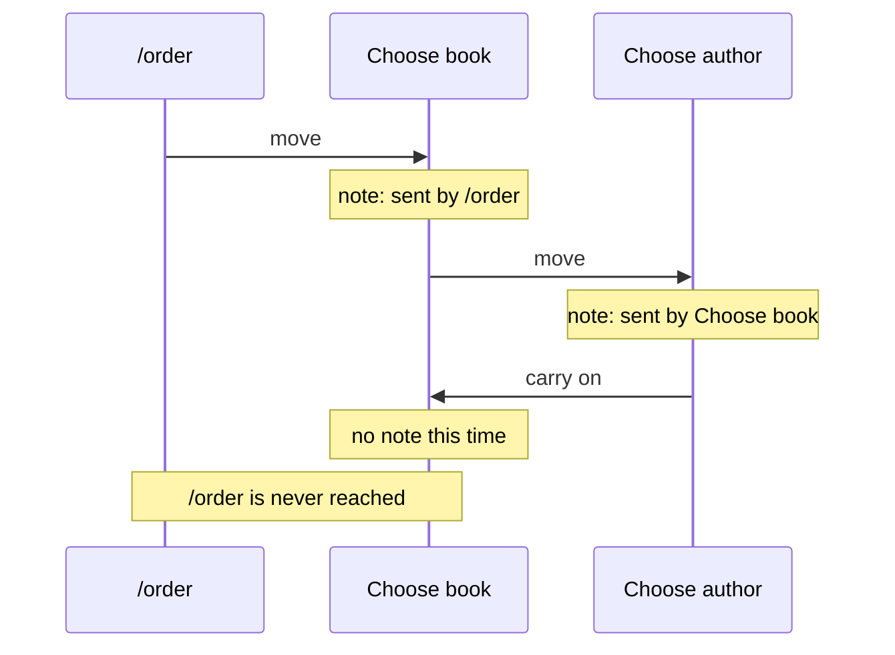
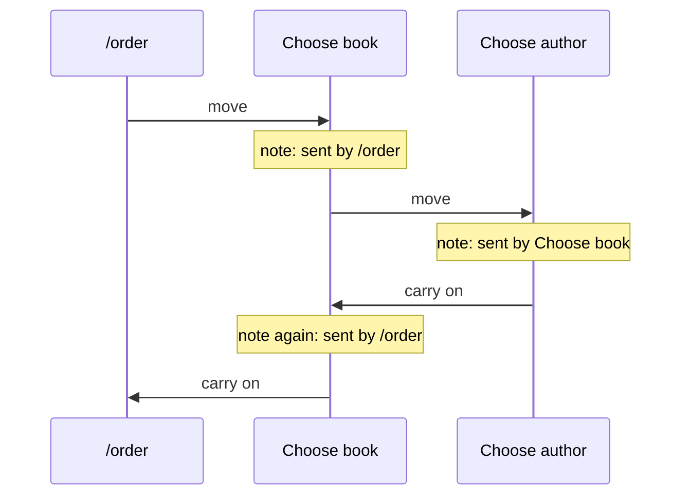
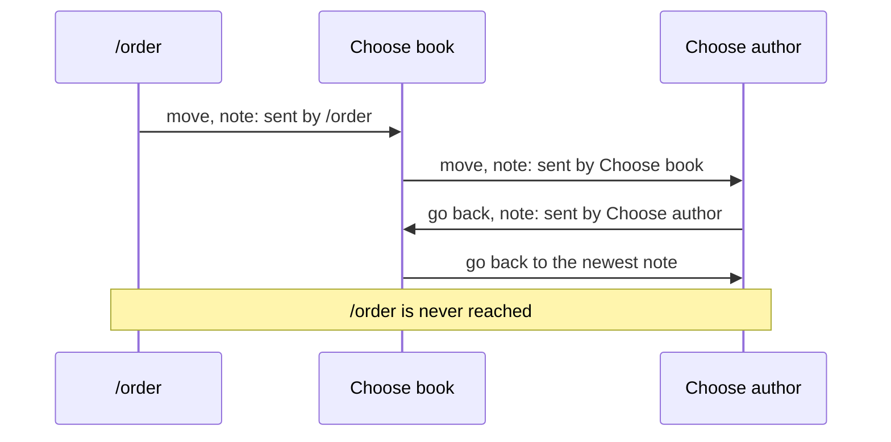

# What would it take to carry on after nested questions?

- **Status:** In Review
- **Release:** Unreleased
- **Spike:** none filed — follows on from
  [How could KitCli know where a command was sent from](how-does-a-command-know-where-it-was-sent-from.md)
- **Time-box:** none agreed — ran inline
- **Date:** 2026-10-17

## Verdict

**New complexity.** When the user comes back to a command, KitCli must give
that command back the note it had the first time, so it can carry on in turn.

`/order` sends the user to Choose book. The user picks "Browse by author", so
Choose book sends them on to Choose author. After they pick an author, the app
should carry on with Choose book, now listing that author's books, then
`/order`.

| Term | Meaning |
|---|---|
| Command | One step the app runs, such as `/order`. |
| Move | One command handing over to the next, written `ByMovingToCommand`. |
| Note | What KitCli writes when it follows a move: "Choose book was sent here by `/order`". |
| Carry on | A command telling KitCli it is done, written `ByCarryingOn()`, so KitCli sends the user back. |

### With one note per command

The [previous investigation](how-does-a-command-know-where-it-was-sent-from.md)
writes no note when the user is sent back. So Choose book comes back from
Choose author with no note, and stops:

### After this work

When KitCli sends the user back to a command, it hands that command the note
it had the first time:

The app's developer writes nothing extra. Each question still ends with `ByCarryingOn()`.

## Recommendation

**One delivery ticket, after the previous investigation's tickets: carrying
on restores the note the command had when it first ran.** Part of the same
minor release.

## What was established

| Fact | Consequence |
|---|---|
| Notes stack up like a pile: a move adds one, carrying on removes one. | Working out a command's note means reading the run's history from the start, not just one step back. |
| The run keeps every command it ran, in order. | The pile can be worked out from that history, with nothing new stored. |
| #152 proposes reading the history the same way to find queued moves. | The two can share one way of reading the history. |

An earlier idea, writing a note on every move including going back, was
rejected. Going back writes a note over the one still needed:

## Evidence

Read against `eec501a`.

| File | Shows |
|---|---|
| `KitCli.Workflow/Run/CliWorkflowRun.cs:164` | Every command that runs is recorded, in order. |
| [Run every queued hop, depth-first](../adr/run-every-queued-hop-depth-first.md) | #152's proposal to work out queued moves by reading the history. |

## Open questions

- A command that keeps sending the user round, with no way out, never
  ends. That is [#173](https://github.com/KitCli/KitCli/issues/173).

## Out of scope

- **One question, then carrying on.** That is the
  [previous investigation](how-does-a-command-know-where-it-was-sent-from.md).
