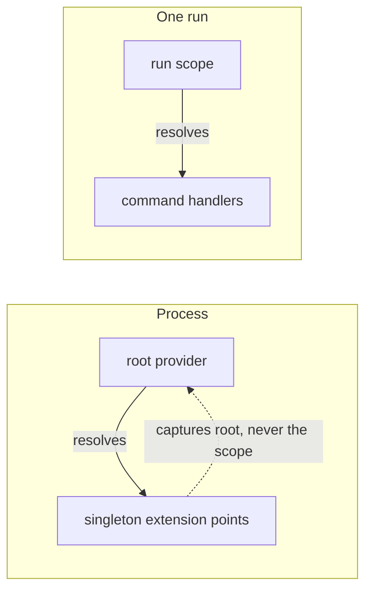
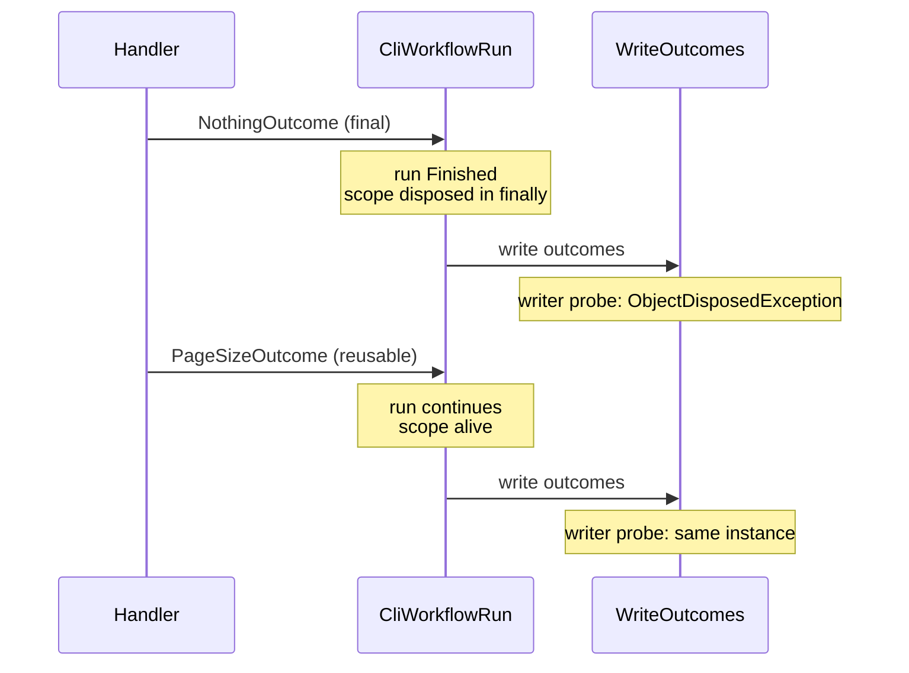

# Which extension points can use a consumer's registered lifetimes?

- **Status:** In Review
- **Release:** Unreleased
- **Spike:** not yet filed
- **Time-box:** none agreed — ran inline
- **Date:** 2026-08-24

## Verdict

**New complexity.** The per-run scope exists, but only command handlers resolve from it, so a consumer's `Scoped` registration fails at startup and their `Transient` registration is **silently** kept for the life of the process. Fixing it spans the instruction pipeline, command factories, artefact factories and writers, and moves scope disposal out of `CliWorkflowRun` into the host: milestone-scale, not a ticket.

| Term | Meaning |
|---|---|
| Root provider | The container built at startup. Singletons live here. |
| Run scope | The per-run scope from the [scope-per-run ADR](../adr/di-scope-per-workflow-run.md). `Scoped` services live here. |
| Extension point | A service KitCli calls during a run: instruction pipeline, command factories, artefact factories, writers. |
| `Singleton`, `Scoped`, `Transient` | A service that lives for the process, the run or one resolution. |

### Today

Handlers reach the run scope. Every other extension point is a singleton built from the root provider:



Two mechanisms cause it, and neither is visible to `ValidateScopes` or `ValidateOnBuild`:

| Consumer registers | Held by a singleton | Result |
|---|---|---|
| `Scoped` | Fails at startup | Loud. |
| `Transient` | Becomes a singleton | **Silent.** The graph is legal, so nothing flags it. |

## Recommendation

Accept the [run-scope ADR](../adr/resolve-the-whole-run-from-its-scope.md), which supersedes the [scope-per-run ADR](../adr/di-scope-per-workflow-run.md): every KitCli service that executes during a run is registered `Transient` and resolved from the run's scope. Only `ICliIo`, `ICliWorkflow` and `CliApp` stay `Singleton`.

Slice under the *Scope Dependency Injection Per Workflow Run* milestone, by area board: Workflow (#6), Commands (#9), Artefacts (#10). Delivery order needs a joint planning pass; this document does not imply one.

## What was established

The permanent home for these is [microsoft-dependency-injection.md](../technology/microsoft-dependency-injection.md).

| Fact | Consequence |
|---|---|
| Effective lifetime is `max(registered, holder's)`. | Registration is a floor, not a ceiling. |
| A singleton injecting `IServiceProvider` captures the *root* provider, even when the singleton is resolved from a scope. | `CliWorkflowCommandProvider` does this. MediatR's transient `Mediator` does not, which is the only reason handlers reach the scope. |
| `Transient` inside `Singleton` raises no validation error. `Scoped` inside `Singleton` throws at startup. | The silent case is the more dangerous. |
| `ValidateOnBuild` does not inspect instance registrations, factory lambdas or open generics. It does inspect keyed type registrations. | KitCli uses instance registrations in the artefact discovery loops and for `IOptions<InstructionSettings>`, so those go unchecked. |
| The run scope is disposed before outcomes are written, inside `ExecuteCommand`'s `finally`, two frames below `CliApp.WriteOutcomes`. | The scope survives a command that returns a reusable outcome and dies on one that ends the run. |
| Consumer artefact factories are built by `Activator.CreateInstance` and registered as instances. The DI-constructed path, `AddArtefactFactory<T>()`, is `private`. | They take no constructor dependencies at any lifetime. |
| The container holds 29 descriptors: 25 singleton, 4 transient, zero scoped. | Almost nothing resolves per run today. |

The disposal order, from the evidence below:



## Evidence

All checks run against `net10.0`,
`Microsoft.Extensions.DependencyInjection` 10.0.2, MediatR 12.4.1.

Root capture (2), resolving both locators from the same scope:

```
scope resolves ScopedThing directly -> 48e20035-…
transient locator (ISender shape)   -> 48e20035-…   same instance
singleton locator (provider shape)  -> InvalidOperationException:
                                        Cannot resolve scoped service from root provider.
```

Disposal ordering (5), driving a real `CliWorkflowRun` with a real
`IServiceScope` and probing where `WriteOutcomes` would run:

```
command returns NothingOutcome  (Final    -> run Finished)
    run Finished : True     writer probe : ObjectDisposedException
command returns PageSizeOutcome (Reusable -> run continues)
    run Finished : False    writer probe : scope ALIVE (same instance)
```

Silent transient promotion (3):

```
Built OK - a transient inside a singleton is never a validation error.
singleton extension point : SAME instance - transient silently promoted
transient extension point : fresh each time - respected
```

Validation coverage (4):

```
factory lambda  -> built OK  (ValidateOnBuild did NOT catch it)
open generic    -> built OK  (ValidateOnBuild did NOT catch it)
keyed type      -> threw at build (caught)
plain type      -> threw at build (caught)
```

Artefact factory tiers (6): `AddSingleton<IFactory, NeedsScopedDep>` fails
at build with *"Cannot consume scoped service"*, while
`Activator.CreateInstance` on the same type throws
`MissingMethodException: No parameterless constructor defined` — at
registration, not as a DI error.

## Open questions

- Does this enter via the [KitCli Ideas](https://github.com/orgs/KitCli/projects/1)
  board for a WAG, or straight to the milestone? It is review-surfaced
  tech-debt rather than a floated idea, which the routing convention does
  not obviously cover.
- Should the `Activator`-built artefact factories move to DI construction
  in this milestone or a separate one? The run-scope ADR deliberately excludes it.
- Does per-run construction of the instruction pipeline and the eight
  writers cost anything measurable on a long interactive session? Not
  benchmarked.
- `WithJsonSettings` passes `reloadOnChange: true`, which
  `InstructionSettings` cannot honour because it is registered through
  `OptionsWrapper`. In scope here or its own ticket?

## Out of scope

- **MediatR's own dispatch behaviour.** Only its DI registrations were
  examined. Its technology page does not exist yet and is explicitly not
  part of this milestone.
- **Whether the per-run boundary is right at all.** The scope-per-run ADR chose run
  over command and that choice was re-affirmed, not re-examined.
- **Consumer-facing docs.** No user guide or concept doc was written or
  checked for staleness against these findings.
