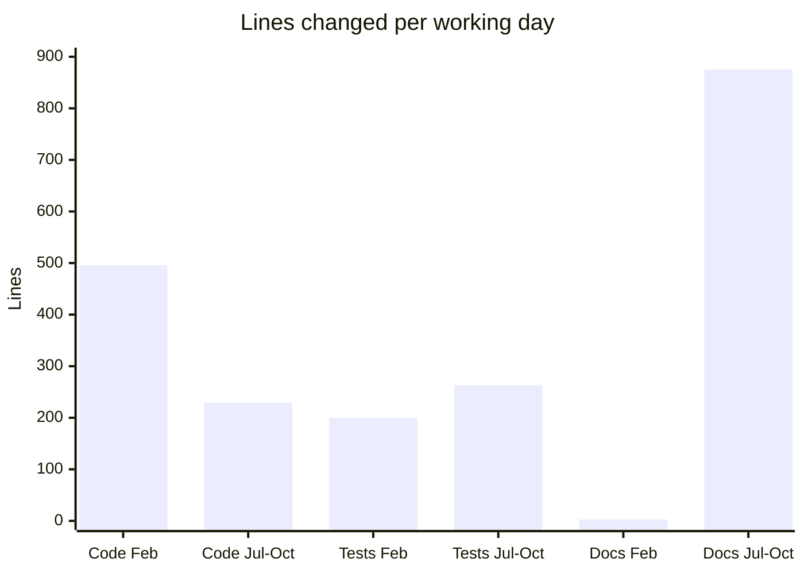
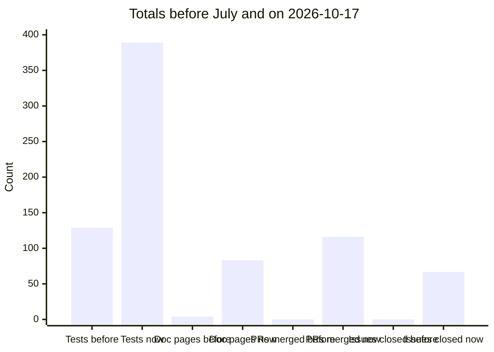

# 0003. Development pace review

Date: 2026-10-17

**This is a snapshot, not current state.** It compares KitCli's git
history before and after the maintainer started using Claude Code on
2026-07-22, up to `main` on the date above.

## Summary

The pace held steady at 8 commits per working day, and the mix of work
changed: since July, more than half of each day's changes are
documentation, and tests have tripled.

## Methodology

Each commit on `main` counts once (`git log main --first-parent`), so a
squash-merged pull request is one commit. 167 of the 192 commits since
July carry a `Co-authored-by: Claude` trailer. The release bot's 9
version bumps are left out. A working day is a date with at least one
commit. Changed lines are lines added plus lines deleted: `.md` files
count as docs, `.cs` files in a test project as tests, other `.cs` files
as code.

## Findings

February is the baseline. January holds the first scaffolding, which is
half of all lines added before July.

## Caveats

- **Working days are not hours.** Git records the day of a commit, not
  how long the work took, so history alone cannot compare hour for hour.
- **Squash merges hide intermediate commits**, so commit counts since
  July understate the steps taken.
- **No issues or pull requests existed before July**, so those counts
  show the new process, not a speed-up.
- **Lines are not value.** A line of documentation and a line of code
  take different effort.
