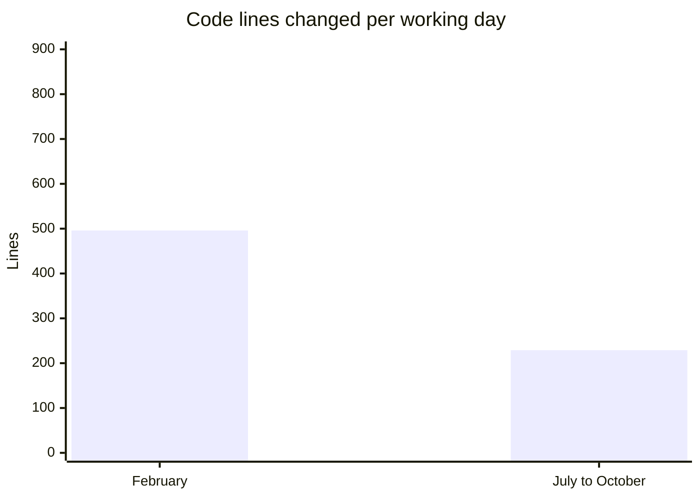
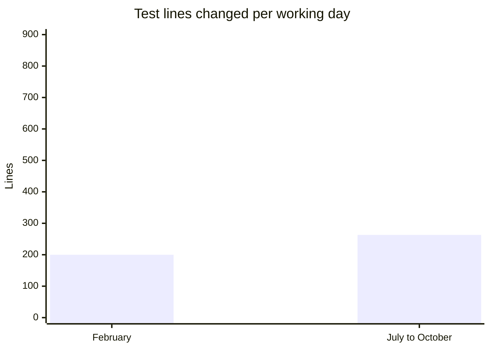
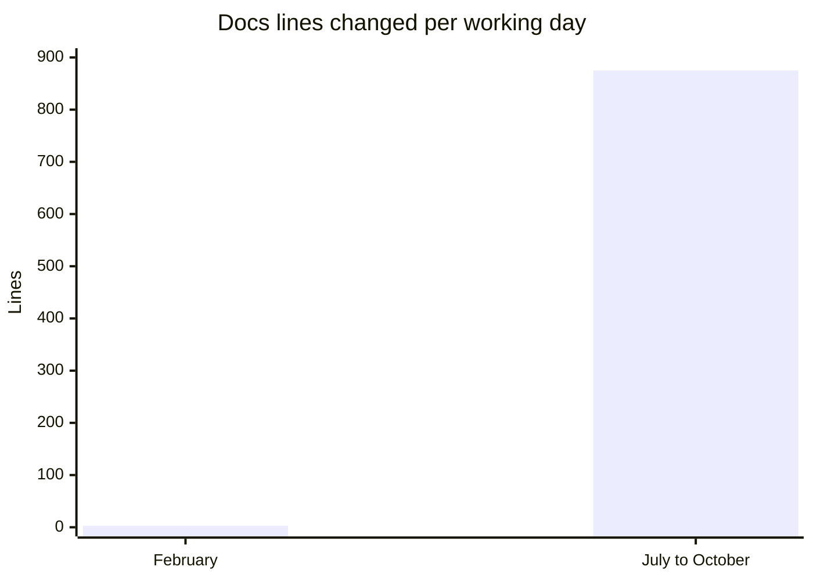

# 0003. Development volume review

Date: 2026-10-17

**This is a snapshot, not current state.** It compares how much work
landed in KitCli before and after the maintainer started using Claude
Code on 2026-07-22, up to `main` on the date above. It measures volume,
not pace: lines changed say how much was written, not how fast finished
work shipped.

## Summary

A working day produces 8 commits in both periods. Since July, more of
each day goes to tests and documentation and less to code. Tests grew
from 129 to 389, and documentation pages from 4 to 83.

## Methodology

Each commit on `main` counts once (`git log main --first-parent`), so a
squash-merged pull request is one commit. 167 of the 192 commits since
July carry a `Co-authored-by: Claude` trailer. The release bot's 9
version bumps are left out. A working day is a date with at least one
commit. Changed lines are lines added plus lines deleted: `.md` files
count as docs, `.cs` files in a test project as tests, other `.cs` files
as code.

February is the baseline, with 8 working days against 24 since July.
January holds the first scaffolding, which is half of all lines added
before July.

## Findings

## Caveats

- **Working days are not hours.** Git records the day of a commit, not
  how long the work took.
- **Squash merges hide intermediate commits**, so commit counts since
  July understate the steps taken.
- **Lines are not value.** Tidying code lowers its line count, and a
  line of documentation takes different effort from a line of code.
