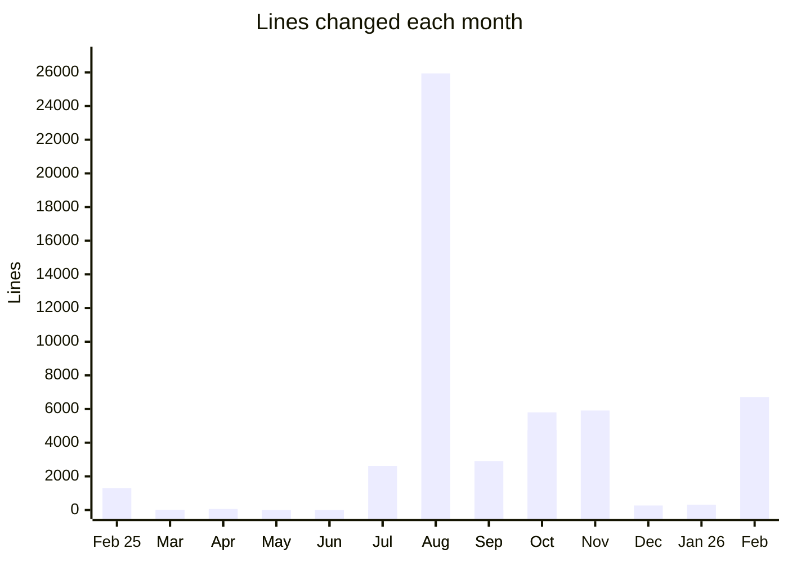

# 0003. Development volume review

Date: 2026-10-17

**This is a snapshot, not current state.** It compares how much work
landed in KitCli before and after the maintainer started using Claude
Code on 2026-07-22. It measures volume, not pace: lines changed say how
much was written, not how fast finished work shipped.

## Summary

Before Claude, a working day changed about 420 lines. Since July it
changes about 1,450: about 590 lines of code and tests, and 860 of
documentation. Code and tests alone are up by about 40%.

## Methodology

KitCli started inside the
[SpendfulnessCli](https://github.com/joshuaedwardcrowe/SpendfulnessCli)
repository and moved to its own on 2026-01-28. Its history up to then
is the SpendfulnessCli folders that became KitCli: `Cli` and every
`Cli.*` folder except `Cli.Spendfulness.*`, plus `YnabCli.Instructions`
and `YnabProgressConsole.Instructions`, which became `Cli.Instructions`.
From 2026-01-28 it is every commit on KitCli's `main`, leaving out the
commits that copied the code across and the release bot's version
bumps.

A changed line is a line added or deleted. A moved file counts only
its edits. A working day is a date with at least one commit: 49 before
July 2026, 25 since.

## Findings

Claude Code wrote with the maintainer from July 2026 onwards. 171 of
the 196 commits since then carry its `Co-authored-by` trailer.

## Caveats

- **Working days are not hours.** Git records the day of a commit, not
  how long the work took.
- **Documentation is most of the growth.** 21,548 of the 36,218 lines
  changed since July are in `.md` files, against 25 lines before.
- **Lines are not value.** Tidying code lowers its line count, and a
  line of documentation takes different effort from a line of code.
