# Development volume review, October 2026

Date: 2026-10-17

**This is a snapshot, not current state.** It compares how much work
went into KitCli before and after its maintainer started using Claude
Code, an AI coding assistant, on 2026-07-22.

## Summary

Since the maintainer started using Claude, each day of work produces
about 250% more: around 1,450 lines changed a day, up from 420. Most of
the increase is documentation. Code and tests alone are up about 40%.

This measures how much was written, not how fast finished features
reached users.

## Methodology

Each saved change to the code is a commit. The count covers every line
those commits added or removed, and moving a file counts only the lines
edited in it. A working day is any date with at least one commit: 49
before July 2026, 25 since. Commits written with Claude are marked as
such in their message.

KitCli began as part of another project,
[SpendfulnessCli](https://github.com/joshuaedwardcrowe/SpendfulnessCli),
and moved to its own home on 2026-01-28. Before that date, the count
covers only the SpendfulnessCli folders that became KitCli: `Cli` and
every `Cli.*` folder except `Cli.Spendfulness.*`, plus
`YnabCli.Instructions` and `YnabProgressConsole.Instructions`. After it,
the count covers every KitCli commit, except the ones that copied the
code across and the ones a bot makes to bump version numbers.

## Findings

```mermaid
---
config:
  xyChart:
    height: 640
  themeVariables:
    xyChart:
      plotColorPalette: "#D97757, #6B7280"
---
xychart-beta horizontal
    title "Lines changed each month, in thousands"
    x-axis ["Feb 2025", "Mar 2025", "Apr 2025", "May 2025", "Jun 2025", "Jul 2025", "Aug 2025", "Sep 2025", "Oct 2025", "Nov 2025", "Dec 2025", "Jan 2026", "Feb 2026", "Mar 2026", "Apr 2026", "May 2026", "Jun 2026", "Jul 2026", "Aug 2026", "Sep 2026", "Oct 2026"]
    y-axis "Thousands of lines" 0 --> 27
    bar [1.3, 0.0, 0.1, 0.0, 0.0, 0.0, 0.0, 0.0, 5.8, 5.9, 0.3, 0.3, 6.7, 0.0, 0.0, 0.0, 0.0, 2.6, 25.9, 2.9, 4.7]
    bar [1.3, 0.0, 0.1, 0.0, 0.0, 0.0, 0.0, 0.0, 5.8, 5.9, 0.3, 0.3, 6.7, 0.0, 0.0, 0.0, 0.0, 1.8, 1.9, 0.0, 0.5]
```

Each bar is one month. Grey is work done without Claude. Orange is work
done with Claude. Gaps are months with no work.

## Caveats

- **Working days are not hours.** A commit records the day it was made,
  not how long the work took.
- **Documentation is most of the growth.** 21,548 of the 36,218 lines
  changed since July are documentation, against 25 lines before.
- **More lines is not better work.** Tidying code often removes lines,
  and a line of documentation takes different effort from a line of
  code.
