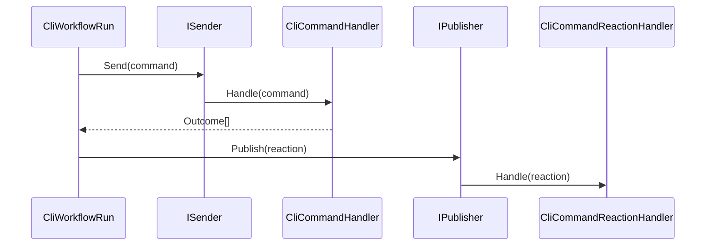
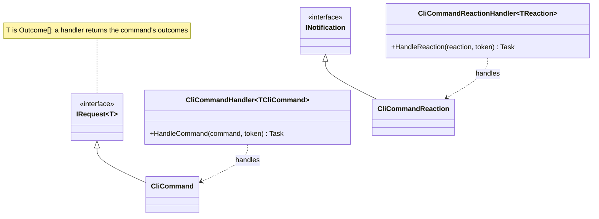

# MediatR

**KitCli dispatches every command through [MediatR](https://github.com/jbogard/MediatR) 12.4.1 on `net10.0`. A consumer writes a handler and a reaction handler. Pipeline behaviours, publishing strategies and streaming have no KitCli support.** This page answers "can I do X with MediatR": which features KitCli supports, and where each one stops. For *why* KitCli uses it, see the [MediatR ADR](../adr/mediatr-for-command-dispatch.md).

| Term | Meaning |
|---|---|
| Command | A `CliCommand`, which is an `IRequest<Outcome[]>`. |
| Handler | A `CliCommandHandler<T>`, which is an `IRequestHandler<T, Outcome[]>`. |
| Reaction | A `CliCommandReaction`, which is an `INotification`. |
| Reaction handler | A `CliCommandReactionHandler<T>`, which is an `INotificationHandler<T>`. |

## How a command reaches its handler

`AddCommandsFromAssembly` registers handlers with `AddMediatR(cfg => cfg.RegisterServicesFromAssembly(assembly))` (`CommandServiceCollectionExtensions.cs:57`). Each run resolves `ISender` and `IPublisher` from its scope (`CliWorkflow.cs:84`, `:88`).



`Send` is `CliWorkflowRun.cs:162`. `Publish` is `:242`, once per reaction in the outcomes.

## What a consumer writes



```csharp
public record GreetCliCommand : CliCommand;

public class GreetCliCommandHandler : CliCommandHandler<GreetCliCommand>
{
    public override Task<Outcome[]> HandleCommand(GreetCliCommand command, CancellationToken cancellationToken)
        => FinishThisCommand().ByFinallySaying("Hello").EndAsync();
}
```

## Features

| MediatR feature | Supported | Where it stops |
|---|---|---|
| `IRequest` / `IRequestHandler` | Yes | Only through `CliCommand` and `CliCommandHandler<T>`. The response is always `Outcome[]` (`CliCommand.cs:13`). |
| `INotification` / `INotificationHandler` | Yes | Only through `CliCommandReaction` and `CliCommandReactionHandler<T>` (`CliCommandReaction.cs:9`). |
| Pipeline behaviours | Not built in | KitCli registers none. A consumer's `IPipelineBehavior<,>` is untested. See [Gaps](#gaps). |
| `INotificationPublisher` | Default only | KitCli never sets one. The default awaits handlers one at a time. |
| Streaming (`IStreamRequest`) | No | No command can return a stream. No source refers to it. |
| `MediatR.Contracts` alone | No | Every project that references MediatR references the full package. |
| A second `AddMediatR` call | Yes | See below. |

**Reactions publish together, handlers run in turn.** `CliWorkflowRun.cs:242` starts every `Publish` then awaits them with `Task.WhenAll`. The default publisher awaits one reaction's handlers in order. A handler that throws ends the whole session ([reactions](../user-guides/command-reactions.md)).

| Project | `MediatR` | `MediatR.Contracts` |
|---|---|---|
| `KitCli.Commands.Abstractions` | 12.4.1 (`.csproj:24`) | 2.0.1 (`.csproj:25`) |
| `KitCli` | 12.4.1 (`.csproj:18`) | transitive |
| `KitCli.Tests` | 12.4.1 (`.csproj:10`) | transitive |

`CliCommand` and `CliCommandReaction` need only the contracts package. `CliCommandHandler<T>` implements `IRequestHandler`, which lives in the full package, so `KitCli.Commands.Abstractions` needs both. The `KitCli` reference is unused ([#32](https://github.com/KitCli/KitCli/issues/32)).

## Calling AddMediatR yourself

KitCli already calls `AddMediatR` once per assembly: the built-in commands, the entry assembly, and every registry through `AddCommandsFromAssembly`. A call from consumer code adds its handlers and behaviours to the same container.

**MediatR registers `IMediator`, `ISender`, `IPublisher` and the notification publisher with `TryAdd`, so the first call to set them wins.** A later `cfg.NotificationPublisherType` or `cfg.Lifetime` is ignored. Checked against MediatR 12.4.1: after a second call that sets `TaskWhenAllPublisher` and `Singleton`, the container still holds one transient `IMediator` and resolves the default `ForeachAwaitPublisher`. Handlers are not registered twice.

## Gaps

- **No pipeline behaviours.** Logging or validation around every command has nowhere to live. Tracked in [#119](https://github.com/KitCli/KitCli/issues/119) as a seam for cross-cutting behaviour. The ADR's alternatives name the pipeline-behaviour seam too.
- **No publisher choice.** No issue exists for choosing an `INotificationPublisher`.
- **No streaming.** No issue exists.
- **No contracts-only package.** No issue exists.
- **No explanation of reaction resolution.** Tracked as [#238](https://github.com/KitCli/KitCli/issues/238).

## See also

- [MediatR for command dispatch ADR](../adr/mediatr-for-command-dispatch.md)
- [Command registration](../concepts/command-registration.md)
- [Command reactions](../user-guides/command-reactions.md)
- [Microsoft.Extensions.DependencyInjection](microsoft-dependency-injection.md)
