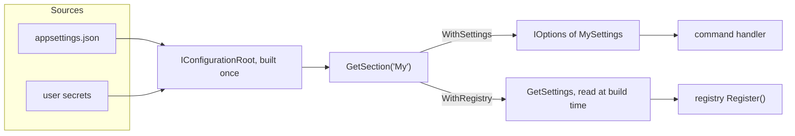

# Microsoft.Extensions.Configuration

**KitCli reads settings from one JSON file and the app's user secrets, and
binds one section per settings type.** This page answers "can I bind X from Y":
which features KitCli supports, and where each one stops. For how settings
reach your app step by step, see [App configuration](../concepts/app-configuration.md).

| Term | Meaning |
|---|---|
| Source | A configuration provider added to the builder: a JSON file or user secrets. |
| Section | The part of the merged configuration that holds one settings type. |
| Binding | Copying a section's values onto a settings object. |

`KitCli/KitCli.csproj` (lines 19-23) references `Microsoft.Extensions.Configuration.Json`,
`Microsoft.Extensions.Configuration.UserSecrets` and
`Microsoft.Extensions.Options.ConfigurationExtensions`, all 10.0.2. Consumers
meet them through `CliAppBuilder`.

## Sources

| Source | Supported | Where it stops |
|---|---|---|
| JSON file | Yes, `WithJsonSettings(fileName)` (`CliAppBuilder.cs:89`) | Resolved against the current directory, not the app's folder. A missing file is skipped (`optional: true`). |
| User secrets | Yes, `WithUserSecretSettings()` (`CliAppBuilder.cs:70`) | Reads the calling assembly's secrets. A project without a `UserSecretsId` loads nothing and does not fail. |
| Environment variables | No | No `AddEnvironmentVariables` call exists. No issue tracks it. |
| Command-line arguments | No | KitCli parses instructions itself and adds no configuration provider. No issue tracks it. |
| Several JSON files, layered | Partly | Calling `WithJsonSettings` twice layers them, later wins, but only before the first `WithSettings` or `WithRegistry` call (below). |

**User secrets load in every environment.** The call has no Development check, unlike
ASP.NET Core, so a published app reads the secrets file of any machine that has one.

**The configuration is built once.** The first `WithSettings` or
`WithRegistry<TSettings, TRegistry>` call builds the `IConfigurationRoot`
(`CliAppBuilder.cs:110`, `:237`) and later calls reuse it. A source added after
that call is ignored without error: [#345](https://github.com/KitCli/KitCli/issues/345).

## Binding shapes

| Shape | Supported | Where it stops |
|---|---|---|
| `IOptions<T>` | Yes, `WithSettings<T>()` calls `Configure<T>` (`:119`) | Value is fixed after first read. |
| `IOptionsSnapshot<T>` / `IOptionsMonitor<T>` | Yes, same call | `WithSettings<T>` only, not `InstructionSettings`. |
| Settings instance in a registry | Yes, `WithRegistry<TSettings, TRegistry>()` (`:151`, `:263`) | Read once while the chain runs. |
| Section named by hand | No | The name is the type name with every "Settings" removed (`:115`, `:242`): `MySettings` reads `My`. |
| Nested sections, `IOptionsFactory`, named options | Not wired | Nested properties bind through the library; KitCli adds nothing for named options. No issue tracks it. |

## Errors and missing sections

| Case | Result | Evidence |
|---|---|---|
| `WithSettings<T>` before any source | Throws "You must call With[..]Settings before calling WithSettings." | `:105` |
| `WithSettings<T>`, section missing | Binds to the type's defaults, no error | `:117-119` |
| `WithRegistry<TSettings, TRegistry>`, section missing | Throws "No configuration section found for ..." | `:260` |
| Either method, `InstructionSettings` or `KitCliSettings`, section missing | Their own defaults | `:248-256` |
| Value cannot convert, such as `"abc"` for an `int` | Throws from the library when `section.Get<T>()` runs, or on the first `IOptions<T>.Value` read | the library, not KitCli |
| File is not valid JSON | Throws when the configuration builds | the library, not KitCli |

**A missing section with `WithSettings<T>` binds defaults, so the failure moves to
the code that reads a null property.** Tracked as
[#325](https://github.com/KitCli/KitCli/issues/325).

## Reload

Both sources pass `reloadOnChange: true` (`:70`, `:89`), so the provider re-reads
the file when it changes. What reaches your code depends on the accessor.

| Reader | Sees the change |
|---|---|
| `IOptionsMonitor<T>` | Yes |
| `IOptionsSnapshot<T>` | On the next run, since its scope is one run |
| `IOptions<T>` | No |
| `InstructionSettings` | No, frozen in an `OptionsWrapper` (`:308`). [#139](https://github.com/KitCli/KitCli/issues/139) |
| Settings a registry received | No, read once at build time. No issue tracks it. |

## Gaps

- **Two sources only.** No environment variables or command-line provider, and no
  issue tracks adding them.
- **A source added after the first read is dropped silently.** [#345](https://github.com/KitCli/KitCli/issues/345).
- **A missing section binds defaults in `WithSettings<T>`.**
  [#325](https://github.com/KitCli/KitCli/issues/325).
- **`InstructionSettings` ignores reload.** [#139](https://github.com/KitCli/KitCli/issues/139).
- **`InstructionSettings` sits beside `KitCliSettings`, not in it.**
  [#301](https://github.com/KitCli/KitCli/issues/301).

## See also

- [App configuration](../concepts/app-configuration.md)
- [Microsoft.Extensions.DependencyInjection](microsoft-dependency-injection.md)
- [Settings beside CliIo ADR](../adr/keep-message-level-and-settings-beside-cli-io.md)
