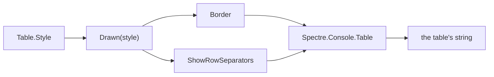

# Spectre.Console

**KitCli draws tables and shows choice prompts through
[Spectre.Console](https://github.com/spectreconsole/spectre.console) 0.57.2 on
`net10.0`. A consumer picks one of nineteen table borders with `Table.Style`.**
For how a table is *built*, see [tables.md](../concepts/tables.md). Why the
library changed is in the [Spectre.Console ADR](../adr/render-tables-with-spectre-console.md).

| File | Uses Spectre.Console for |
|---|---|
| `KitCli.Abstractions/Tables/Table.cs` | `Table.ToString()` draws the table |
| `KitCli.Abstractions/Io/CliIo.cs` | `SelectionPrompt`, `MultiSelectionPrompt` and `AnsiConsole.Console` |
| `KitCli.Abstractions/Io/HeadlessCliIo.cs` | an `IAnsiConsole` for the headless app |

## Output styles

`Table.Style` is a settable `CliTableStyle` and defaults to `Ascii`. `Drawn(Style)`
in `Table.cs` switches over it to pick the border and whether to rule a line
between rows. `Ascii` is the default arm, so any value without its own arm draws
as `Ascii`.

| Fact | Consequence |
|---|---|
| `CliTableStyle` has 19 members. | The library's other borders are not offered. |
| 10 styles rule a line between rows: `Ascii` and the other ascii, box and double styles. | Rows sit apart. |
| 9 styles leave rows flush: the divider, header-line, `Markdown` and `None` styles. | Rows sit together. |
| `Ascii` is the default and what every table drew before the setting existed. | Existing output does not change. |

| Style | Border | Looks like | Between rows |
|---|---|---|---|
| `Ascii` | `Ascii` | `+---+`, `\|` | line |
| `Box` | `Square` | `┌───┐`, `│` | line |
| `Markdown` | `Markdown` | `\| --- \|` | none |
| `None` | `None` | no border | none |

Every border but `None` draws a line under the header.

## Settings

| Setting | Library default | KitCli uses | Effect |
|---|---|---|---|
| `Table.Border` | `Square` | set from `Style` | which characters draw the box |
| `Table.ShowRowSeparators` | `false` | set from `Style` | a line between rows |
| `Table.ShowHeaders` | `true` | default | whether the header row prints |
| `Table.Width` | unset | unset | fixed width for the whole table |
| `Table.Title` / `Caption` | unset | unset | free text above and below |
| `TableColumn.Width` | unset | `Table.MaxColumnWidth` | see below |
| `TableColumn.Alignment` | left | default | left, centre or right |
| `TableColumn.NoWrap` | `false` | default | never break this column |
| `Profile.Width` | the terminal's | default | see below |

**A column width is exact, not a maximum.** Set 40 and a short value is padded
out to 40. So `Table.MaxColumnWidth` applies only to columns whose widest line
already exceeds it, which keeps its meaning of "wrap here".

**The library measures the real terminal even when writing to a string.** It
falls back to 80 columns only when there is no terminal at all. KitCli leaves
that alone, so a long value wraps inside its column instead of running off the
side of the window.

## Cell values

| Value | Rendered as |
|---|---|
| `string` | itself |
| any other object | `ToString()` |
| `null` | empty cell |
| a string containing `\n` | as many lines, inside its own row |
| a string containing `[` | itself |

**Square brackets would otherwise be read as markup.** The library treats `[red]`
as a colour and throws on anything it cannot resolve, such as the generic type
name ``List`1[System.String]``. KitCli wraps every value in a `Text`, which
prints literally.

A row with more cells than columns throws an `InvalidOperationException` from
`AddRow`. A row with fewer renders the missing cells empty.

## Gaps

- **Other settings are fixed.** A consumer picks a border through `Table.Style`
  ([#210](https://github.com/KitCli/KitCli/issues/210)) but cannot change the
  other settings; the `Spectre.Console.Table` is a local variable inside
  `Table.ToString()`.
- **No row count.** The library has no trailing `Count: n` line, only
  `Caption`, which is free text a caller composes. Tracked as
  [#212](https://github.com/KitCli/KitCli/issues/212).
- **No choice of where a long cell breaks.** The library wraps at word
  boundaries, so a column of file paths cannot prefer `/`. Also
  [#212](https://github.com/KitCli/KitCli/issues/212).
- **No per-column formatting.** `TableColumn.Alignment` is unused, because
  `TableBuilder` flattens every value to text before the renderer sees it.
  Tracked as [#211](https://github.com/KitCli/KitCli/issues/211) and
  [#213](https://github.com/KitCli/KitCli/issues/213).
