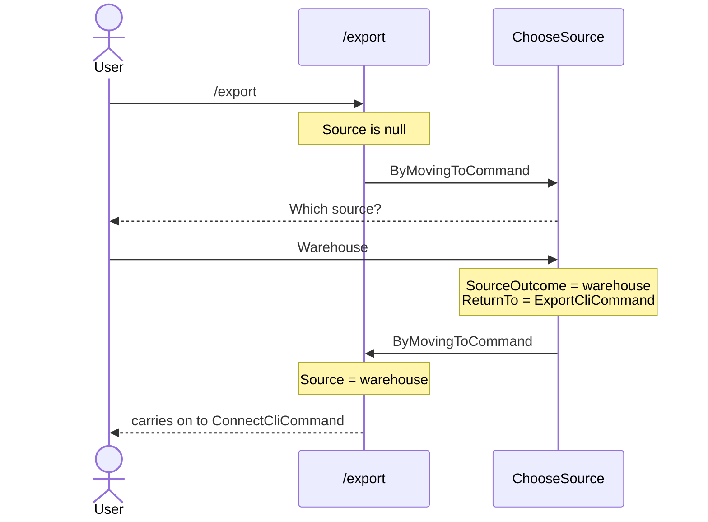

# Asking for a missing value and carrying on

**When a command starts without a value it needs, have it move to a second command that asks the user, and have that command move back.** `/export` then starts again with the value in hand. [Command stacking](../concepts/command-stacking.md) explains why the value travels this way.

| Term | Meaning |
|---|---|
| Asking command | The command that prompts the user, here `ChooseSourceCliCommand`. |
| `ByMovingToCommand` | An outcome that runs another command in the same turn, with no ask. |
| Artefact | A remembered outcome a later factory looks up by type and name. |
| `ICliIo.CanAsk` | `true` when anything is attached to the input to answer. |

## How it looks



## How to do it

**1. Give the asking command the command to move back to.** It holds `null` when nothing sent the user there.

```csharp
public record ChooseSourceCliCommand(Type? ReturnTo) : CliCommand;
```

**2. Write one factory for each command that moves to the asking command.** `LastCommandIs<ExportCliCommand>()` is true when `/export` ran immediately before. This factory builds the asking command only when `/export` moves to it. It needs `AddArtefactFactoriesForAssembly` in your [registry](creating-a-registry.md), or it is always `false`.

```csharp
public class ChooseSourceAfterExportCliCommandFactory : CliCommandFactory<ChooseSourceCliCommand>
{
    public override bool CanCreateWhen() => LastCommandIs<ExportCliCommand>();
    public override CliCommand Create() => new ChooseSourceCliCommand(typeof(ExportCliCommand));
}
```

**3. Ask, remember the answer, and move back.** `ChooseAsync` returns `null` when the user presses Ctrl+C. End there: every later `ChooseAsync` call returns `null` at once, so asking again loops forever. Move back only when `ReturnTo` is set, because moving to `null` crashes the app.

```csharp
public class ChooseSourceCliCommandHandler(ICliIo io) : CliCommandHandler<ChooseSourceCliCommand>
{
    public override async Task<Outcome[]> HandleCommand(ChooseSourceCliCommand command, CancellationToken ct)
    {
        var picked = await io.ChooseAsync("Which source?", [new("Warehouse", "warehouse"), new("Archive", "archive")], ct);
        if (picked is null)
        {
            return FinishThisCommand().ByFinallySaying("No source chosen.").End();
        }

        var outcomes = FinishThisCommand().ByResultingIn(new SourceOutcome((string)picked.Value!));

        return command.ReturnTo is null
            ? outcomes.End()
            : outcomes.ByMovingToCommand(command.ReturnTo).End();
    }
}
```

`SourceOutcome` is a `Reusable` outcome of your own, with an artefact and an artefact factory beside it. See [Remembering your own state](remembering-your-own-state.md).

**4. In `/export`, move to the asking command when the source is missing.** Have `/export`'s factory read the source with `GetArtefact<string>(nameof(SourceArtefact))?.Value`. It is `null` until the user has chosen one.

```csharp
public override Task<Outcome[]> HandleCommand(ExportCliCommand command, CancellationToken ct)
    => command.Source is null
        ? FinishThisCommand().ByMovingToCommand<ChooseSourceCliCommand>().EndAsync()
        : FinishThisCommand().ByMovingToCommand<ConnectCliCommand>().EndAsync();
```

Typing `/export` with no source chosen now asks for one, then carries on to `ConnectCliCommand`, your next step. To let users run the asking command themselves, as `/source choose`, see [Creating sub-commands](creating-sub-commands.md).

**5. Skip the question when nobody can answer.** Inject `ICliIo` into `/export`'s handler and move to the asking command only when `CanAsk` is `true`. In a headless app it is `false`, and asking throws `NoInputException`.

```csharp
public class ExportCliCommandHandler(ICliIo io) : CliCommandHandler<ExportCliCommand>
{
    public override Task<Outcome[]> HandleCommand(ExportCliCommand command, CancellationToken ct)
    {
        if (command.Source is not null)
        {
            return FinishThisCommand().ByMovingToCommand<ConnectCliCommand>().EndAsync();
        }

        return io.CanAsk
            ? FinishThisCommand().ByMovingToCommand<ChooseSourceCliCommand>().EndAsync()
            : FinishThisCommand().ByFinallySaying("Pass a source to export from.").EndAsync();
    }
}
```

## Common mistakes

- **Asking when nobody can answer.** In a script or a pipeline, asking throws `NoInputException`. Check `CanAsk` as in step 5, and end with `ByFinallySaying` instead of moving to the asking command.
- **Gating on `AnyLastCommandIs`.** It is true when its command ran at any point earlier in the run. When two commands move to the same asking command, both factories can match, and the user can land back on the wrong command. Use `LastCommandIs`.

## Learn more

- [Command stacking](../concepts/command-stacking.md): why the value travels this way.
- [Chaining commands together](chaining-commands.md)
- [Choosing from a list](choosing-from-a-list.md)
- [Creating a headless app](creating-a-headless-app.md): telling headless from interactive inside a command.
