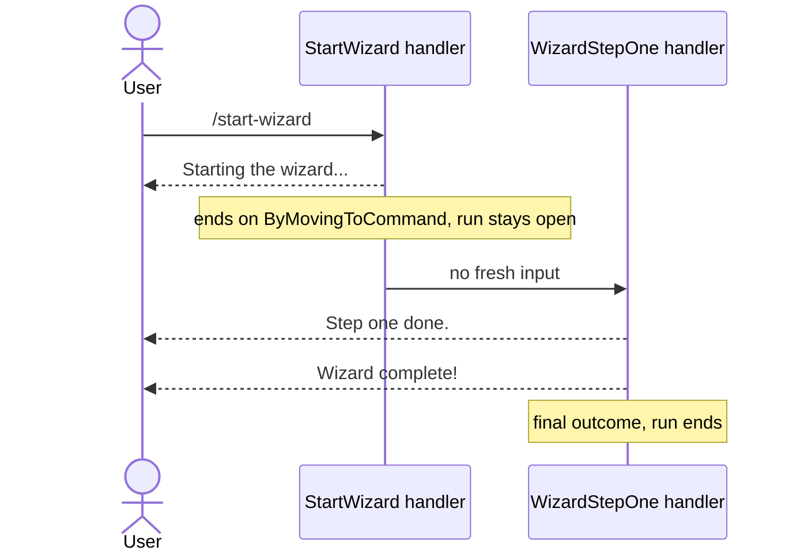

# Chaining commands together

**Call `ByMovingToCommand` from a handler, and KitCli runs the next command with no fresh input.** One ask can run a multi-step wizard, or hand a "list" command off to "show details for the first result".

| Term | Meaning |
|---|---|
| Handler | The class that runs a command and returns its outcomes. |
| Final outcome | An outcome that ends the run, such as `ByFinallySaying`. |
| Run | Every command from the first one up to a final outcome. |

## How it looks



## How to do it

**1. Call `ByMovingToCommand<TCommand>()` last, before `.EndAsync()`.** Name the next command's type; its factory builds it when the run gets there.

```csharp
public class StartWizardCliCommandHandler : CliCommandHandler<StartWizardCliCommand>
{
    public override Task<Outcome[]> HandleCommand(StartWizardCliCommand command, CancellationToken ct)
        => FinishThisCommand()
            .BySaying("Starting the wizard...")
            .ByMovingToCommand<WizardStepOneCliCommand>()
            .EndAsync();
}

public class WizardStepOneCliCommandHandler : CliCommandHandler<WizardStepOneCliCommand>
{
    public override Task<Outcome[]> HandleCommand(WizardStepOneCliCommand command, CancellationToken ct)
        => FinishThisCommand()
            .BySaying("Step one done.")
            .ByFinallySaying("Wizard complete!")
            .EndAsync();
}
```

One ask runs both handlers. Each step runs on its own pass of the host loop, so output appears in order.

**2. End every chain with a final outcome.** Without one, KitCli treats the run as reusable and waits for something else to move it forward. See [Remembering state across separate asks](reusable-outcomes-and-the-workflow-run.md).

**3. Pass data down as arguments.** The next command reads everything the run has gathered, see [Artefacts](../concepts/artefacts.md). For what this handler decides, pass arguments:

```csharp
var limit = new NextCliCommandArgument<int>("limit", 10);

return FinishThisCommand()
    .ByMovingToCommand<ShowBalanceCliCommand>(limit)
    .EndAsync();
```

`ShowBalanceCliCommandFactory` reads it with `GetRequiredArgument<int>("limit")`, as if the user had typed it.

**4. Pick the overload that matches what you know.** The [chain-by-type ADR](../adr/chain-to-a-command-by-type.md) explains why there are several.

| Overload | Use when | The next command's factory |
|---|---|---|
| `ByMovingToCommand<T>()` | You know the type when writing the handler. | Runs, and sees artefacts. |
| `ByMovingToCommand(Type)` | The type is only known at run time. | Runs, and sees artefacts. |
| `ByMovingToCommand(command)` | The command takes its data by constructor and you hold all of it. | Never runs. |

`ByMovingToCommand(Type)` is new in 3.3.0 and throws `ArgumentException` for a type that is not a `CliCommand`:

```csharp
var nextType = typeof(WizardStepOneCliCommand);

return FinishThisCommand()
    .ByMovingToCommand(nextType)
    .EndAsync();
```

## Common mistakes

- **Ending the chain on `ByMovingToCommand(...)`.** That queues one more step. Somewhere a handler must return a final outcome, or the run never completes.
- **Recursing with no way out.** A handler may hand back to its own command (a countdown, a retry, another page) as long as some pass returns a final outcome. With no exit it never returns, and slows as each step grows the history. Nothing detects this ([#173](https://github.com/KitCli/KitCli/issues/173)); `/test-unending-chain` in the playground is the mistake, not the pattern.
- **Expecting the chain to pause for input.** Every step runs back to back. A step needing the user must be reached by a fresh ask, and a headless app has none: see [Creating a headless app](creating-a-headless-app.md).
- **Chaining to a command with constructor arguments and no factory.** KitCli auto-registers a factory only for a command it can build with `new`, so this fails when the chain arrives, not when you write it.
- **Mutating shared state across steps.** Pass data as an argument or read it through an artefact. Never smuggle state between handlers in a static or a singleton.

## Learn more

- [Remembering state across separate asks](reusable-outcomes-and-the-workflow-run.md): what "reusable" means, and how a chain maps onto the run's state.
- [Artefacts](../concepts/artefacts.md): passing data from an earlier step to a later one.
- [Chain to a command by type](../adr/chain-to-a-command-by-type.md): why there are two ways to name the next command.
