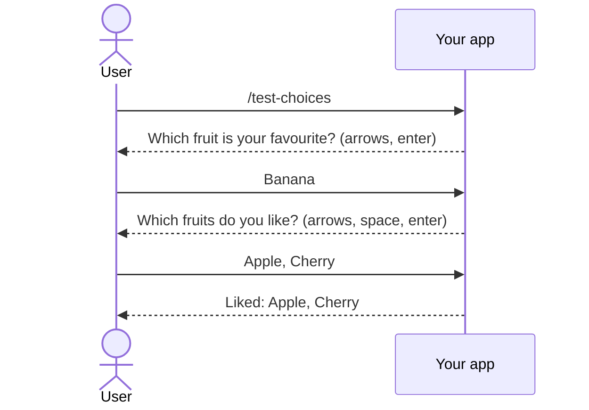

# Choosing from a list

**Ask the person to pick from a list with the arrow keys, rather than make them type a name or number back.** `ChooseAsync` picks one item and `ChooseManyAsync` picks several.

| Term | Meaning |
|---|---|
| `ICliIo` | What a handler asks through. Inject it into the handler. |
| `CliChoice` | One list entry: a `Label` to show and an optional `Value` handed back with the pick. |

## How it looks



## How to do it

**1. Inject `ICliIo` and hand it a list of `CliChoice`.** This is the playground's `/test-choices`.

```csharp
public class TestChoicesCliCommandHandler(ICliIo io) : CliCommandHandler<TestChoicesCliCommand>
{
    private static readonly CliChoice[] Fruits =
    [
        new("Apple", 1),
        new("Banana", 2),
        new("Cherry", 3)
    ];

    public override async Task<Outcome[]> HandleCommand(TestChoicesCliCommand command, CancellationToken ct)
    {
        var favourite = await io.ChooseAsync("Which fruit is your favourite?", Fruits, ct);
        var liked = await io.ChooseManyAsync("Which fruits do you like?", Fruits, ct);

        return FinishThisCommand()
            .BySaying($"Favourite: {favourite?.Label}")
            .ByFinallySaying($"Liked: {string.Join(", ", liked.Select(choice => choice.Label))}")
            .End();
    }
}
```

**2. Read the answer.** Cast `Value` back to what you stored.

| The person | `ChooseAsync` returns | `ChooseManyAsync` returns |
|---|---|---|
| Picks with enter | The picked `CliChoice` | The ticked choices |
| Presses enter with nothing ticked | n/a | An empty list |
| Presses Ctrl+C | `null` | An empty list |

## Common mistakes

- **Printing while the list is showing.** A line written then scrambles the list. Print before you ask, or after the answer.
- **Passing an empty list.** It throws `InvalidOperationException`. Check first.
- **Asking from a headless app.** Nobody is there to answer, so `ChooseAsync` and `ChooseManyAsync` throw `NoInputException`. Check `io.CanAsk` ahead of time, and skip the list when it is `false`.

## Learn more

- [CLI I/O](../concepts/cli-io.md)
- [Ask through CLI I/O with `CliChoice`](../adr/ask-through-cli-io-with-cli-choice.md)
- [Creating a headless app](creating-a-headless-app.md): telling headless from interactive inside a command.
