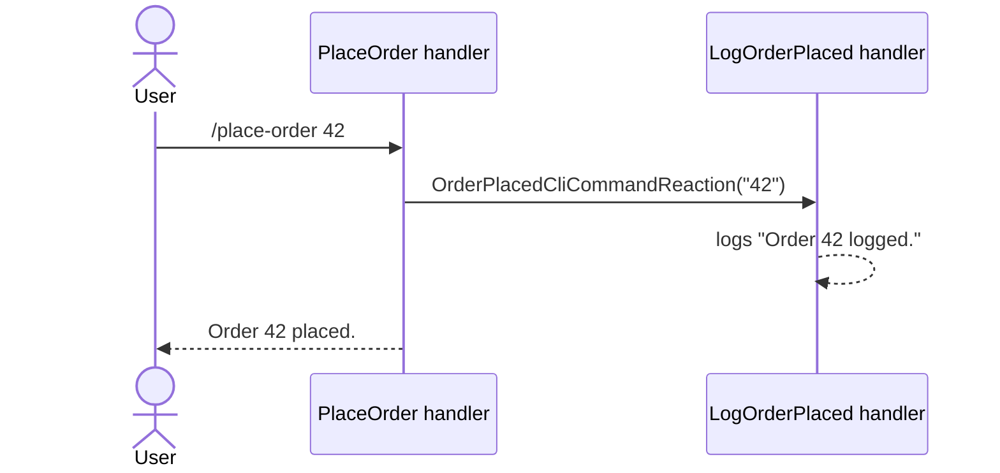

# Running side effects with command reactions

**Raise a reaction from a handler and write one handler per thing that should happen.** An audit log, a cache invalidation or a notification elsewhere then runs without the command knowing who listens.

| Term | Meaning |
|---|---|
| Reaction | A marker record, like a command, that a handler raises with `ByReacting`. |
| Reaction handler | A `CliCommandReactionHandler<T>` that runs when its reaction is raised. |
| Outcome | What a command returns to the user. A reaction is not one the user sees. |

## How it looks



## How to do it

**1. Declare the reaction, raise it with `ByReacting`, and write a handler for it.**

```csharp
public record OrderPlacedCliCommandReaction(string OrderId) : CliCommandReaction;

public class PlaceOrderCliCommandHandler : CliCommandHandler<PlaceOrderCliCommand>
{
    public override Task<Outcome[]> HandleCommand(PlaceOrderCliCommand command, CancellationToken ct)
    {
        var reaction = new OrderPlacedCliCommandReaction(command.OrderId);

        return FinishThisCommand()
            .ByReacting(reaction)
            .ByFinallySaying($"Order {command.OrderId} placed.")
            .EndAsync();
    }
}

public class LogOrderPlacedReactionHandler : CliCommandReactionHandler<OrderPlacedCliCommandReaction>
{
    public override Task HandleReaction(OrderPlacedCliCommandReaction reaction, CancellationToken ct)
    {
        Console.WriteLine($"Order {reaction.OrderId} logged.");
        return Task.CompletedTask;
    }
}
```

Add a second handler for the same reaction and both run. You register neither by hand, and the command handler needs no idea how many exist: zero, one or several.

**2. Let a factory build the reaction.** `ByReacting<TReaction>()` names the reaction by type, as `ByMovingToCommand<TCommand>()` names the next command. A parameterless reaction needs nothing more. A reaction that reads the run's artefacts gets a `CliCommandReactionFactory<TReaction>` in the same assembly:

```csharp
public class OrderPlacedCliCommandReactionFactory
    : CliCommandReactionFactory<OrderPlacedCliCommandReaction>
{
    public override bool CanCreateWhen() => AnyArtefact<string>("OrderId");

    public override CliCommandReaction Create()
    {
        var orderId = GetRequiredArtefact<string>("OrderId").Value;

        return new OrderPlacedCliCommandReaction(orderId);
    }
}
```

The handler then raises it with `.ByReacting<OrderPlacedCliCommandReaction>()`. A reaction with neither a parameterless constructor nor a factory fails the run when published. Build it yourself and use `ByReacting(instance)`.

## Common mistakes

- **Using a reaction to produce something the user should see.** A reaction never reaches an `IOutcomeIoWriter`. Anything in the response to the ask is an `Outcome`: `BySaying`, `ByShowingTable` and the rest.
- **Using a reaction to pass state to a later command.** A reaction handler returns `Task`, and its result is discarded. Use a `Reusable` outcome and an artefact: see [Remembering state across separate asks](reusable-outcomes-and-the-workflow-run.md).
- **Assuming a reaction cannot break the command that raised it.** Reaction handlers are awaited before the command's outcomes return, inside the same try block. One that throws takes the whole run to `Exceptional`. Catch inside the reaction handler when its failure should leave the command alone.
- **Relying on handler order, or on one failure leaving the others alone.** Neither is guaranteed.

## Learn more

- [Remembering state across separate asks](reusable-outcomes-and-the-workflow-run.md): the pattern when a later command must read state.
- [Outcomes](../concepts/outcomes.md): how `ByReacting` fits the outcome model. A `ReactionOutcome` is `Anonymous`-kind and leaves the run's state machine alone.
- [Workflow run state machine](../concepts/workflow-run-state-machine.md): what an exception during a reaction does to the run.
