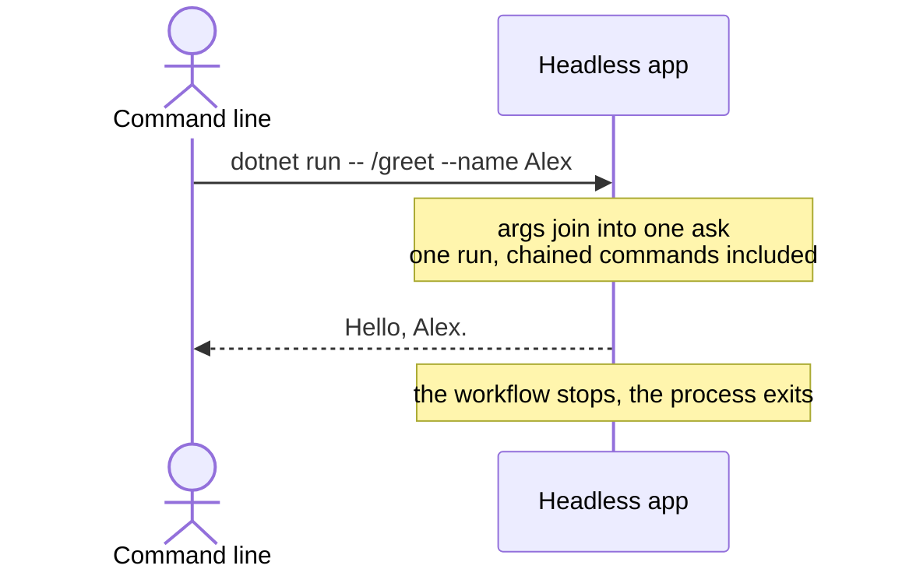

# Creating a headless app

**Subclass `HeadlessCliApp` and your app takes one ask from the command line, runs it and exits.** Use it for scripting, CI, or anything invoked once. For a session someone sits in, see [Creating an interactive app](creating-an-interactive-app.md).

| Term | Meaning |
|---|---|
| Ask | One line of input, e.g. `/greet --name Alex`. |
| Run | Every command from the first one up to a final outcome. |
| Hook | A `virtual` method on `CliApp` that fires at one point in the session. |

## How it looks



## How to do it

**1. Subclass `HeadlessCliApp`.** There is no ready-made basic version, because every headless app needs a constructor forwarding to the base class.

```csharp
public class MyHeadlessApp(ICliWorkflow workflow, ICliIo io) : HeadlessCliApp(workflow, io);
```

**2. Register it in `Program.cs`.**

```csharp
var app = new CliAppBuilder()
    .WithApp<MyHeadlessApp>()
    .WithRegistry<MyAppRegistry>();

await app.Run(args);
```

`args` joins into a single ask string and parses like a line of typed input. `dotnet run -- /greet --name Alex` resolves to the same `GreetCliCommand` an interactive app's `/greet --name Alex` does.

A command that chains with `ByMovingToCommand` (see [Chaining commands together](chaining-commands.md)) runs every step. The limit is one run: no second run can start.

| Fact | Consequence |
|---|---|
| Five hooks fire: `OnSessionStart`, `OnRunCreated`, `OnMovingPastAsk`, `OnRunComplete`, `OnSessionEnd`. | They work as in [Creating an interactive app](creating-an-interactive-app.md). |
| `OnMovingPastAsk` fires once per chained step. | `OnRunComplete` fires after each step too. |
| `OnRunStarted` is obsolete. | Override `OnRunCreated` instead. |

**3. Check `CanAsk` before a command prompts, to serve both app kinds.** A headless app's I/O has nothing attached to its input, so `CanAsk` is false for the life of the process.

```csharp
public class GreetCliCommandHandler(ICliIo io) : CliCommandHandler<GreetCliCommand>
{
    public override Task<Outcome[]> HandleCommand(GreetCliCommand command, CancellationToken cancellationToken)
        => FinishThisCommand()
            .ByFinallySaying(io.CanAsk ? "Hello. What next?" : "Hello, and goodbye.")
            .EndAsync();
}
```

`/test-can-ask` in the playground prints which answer it got.

## Common mistakes

- **Calling `app.Run()` with no arguments.** A headless app cannot ask for one, so `CliAppBuilder.Run` throws an `ArgumentException` naming your app type.
- **Expecting a command to prompt.** Where an interactive session would stop at a reusable checkpoint and take another ask, a headless session ends there with the run unfinished. Put everything a command needs in the args.
- **Reaching for a headless app to script repeated input.** Use one invocation per ask, or an interactive app fed by piped input.

## Learn more

- [Creating an interactive app](creating-an-interactive-app.md): the interactive alternative, and the hooks both modes share.
- [Chaining commands together](chaining-commands.md): running several commands from one ask.
- [CLI app host](../concepts/cli-app-host.md): what `HeadlessCliApp.Run` does, and why the choice between the two hosts is made at compile time.
