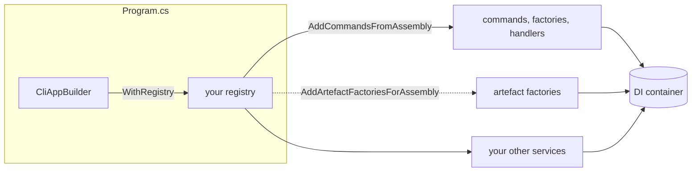

# Creating a registry

**Write one class that names your command assemblies and services, and wire it in with `WithRegistry<T>()`.** `CliAppBuilder` reads it before it builds the DI container.

| Term | Meaning |
|---|---|
| Registry | A class that registers your commands and services into the DI container. |
| Artefact factory | Turns an earlier outcome into a value a later command can look up. |
| Settings | A class bound to a section of your configuration, e.g. `MySettings`. |

## How it looks



## How to do it

**1. Implement `ICliAppRegistry` when registration needs no configuration.**

```csharp
public class MyAppRegistry : ICliAppRegistry
{
    public void Register(IServiceCollection services)
        => services.AddCommandsFromAssembly(typeof(GreetCliCommand).Assembly);
}
```

```csharp
var app = new CliAppBuilder()
    .WithBasicApp()
    .WithRegistry<MyAppRegistry>();

await app.Run();
```

`AddCommandsFromAssembly` scans the assembly for every `CliCommand` and wires up its factory and MediatR handler. Call it once per assembly. The assembly holding your `Program.cs` is scanned already, so a registry serves commands living elsewhere. Register any other services your handlers need as in any DI setup.

**2. Add a second call if your commands remember anything.** It registers the built-in artefact factories as well as yours.

```csharp
var assembly = typeof(GreetCliCommand).Assembly;

services.AddCommandsFromAssembly(assembly);
services.AddArtefactFactoriesForAssembly(assembly);
```

| Add it when | See |
|---|---|
| a command remembers state | [Remembering your own state](remembering-your-own-state.md) |
| a factory calls `LastCommandIs<T>()` | [Gating a command with CanCreateWhen](gating-a-command-with-cancreatewhen.md) |
| a table needs a "next page" step | [Showing a paged table](showing-a-paged-table.md) |

**3. Implement `IConfigurableCliAppRegistry<TSettings>` when registration needs configuration**, such as an API key or connection string.

```csharp
public class MyConfiguredRegistry : IConfigurableCliAppRegistry<MySettings>
{
    public void Register(MySettings settings, IServiceCollection services)
    {
        services.AddSingleton(new MyApiClient(settings.ApiKey));
        services.AddCommandsFromAssembly(typeof(GreetCliCommand).Assembly);
    }
}
```

Call `WithJsonSettings` or `WithUserSecretSettings` first, then the two-type-parameter `WithRegistry`:

```csharp
var app = new CliAppBuilder()
    .WithBasicApp()
    .WithJsonSettings("appsettings.json")
    .WithRegistry<MySettings, MyConfiguredRegistry>();
```

The section name is `TSettings`'s type name with `Settings` removed, so `MySettings` reads the `My` section. To read a different section, rename the settings type.

| Fact | Consequence |
|---|---|
| `WithRegistry<TSettings, TRegistry>()` needs a `With...Settings` call first. | Without one, `CliAppBuilder` throws. |
| `InstructionSettings` and `KitCliSettings` are exempt. | They fall back to their defaults with no call and no section. |
| Any other `TSettings` needs its section in the configuration. | A missing section throws "No configuration section found for ...". |

## Common mistakes

- **Calling `WithRegistry<TSettings, TRegistry>()` with no preceding `With...Settings` call.** `CliAppBuilder` throws, unless `TSettings` is `InstructionSettings` or `KitCliSettings`.
- **Registering one assembly's commands from two registries.** Call `AddCommandsFromAssembly` once per assembly. Your `Program.cs` assembly counts as registered already.
- **Forgetting `AddArtefactFactoriesForAssembly`.** Startup stays silent. The first symptom is a later command's `GetRequiredArtefact` throwing at runtime, or `LastCommandIs<T>()` quietly returning `false`.
- **Passing a marker type from the wrong assembly.** An assembly with no commands throws `ArgumentException` ("No ICommand Implementations Found"). The wrong assembly with some commands registers those and silently skips yours.

## Learn more

- [Writing a basic command](writing-a-basic-command.md): what `AddCommandsFromAssembly` finds and registers.
- [Command registration](../concepts/command-registration.md): the full mechanics behind that call.
- [Artefacts](../concepts/artefacts.md): what the second call registers.
