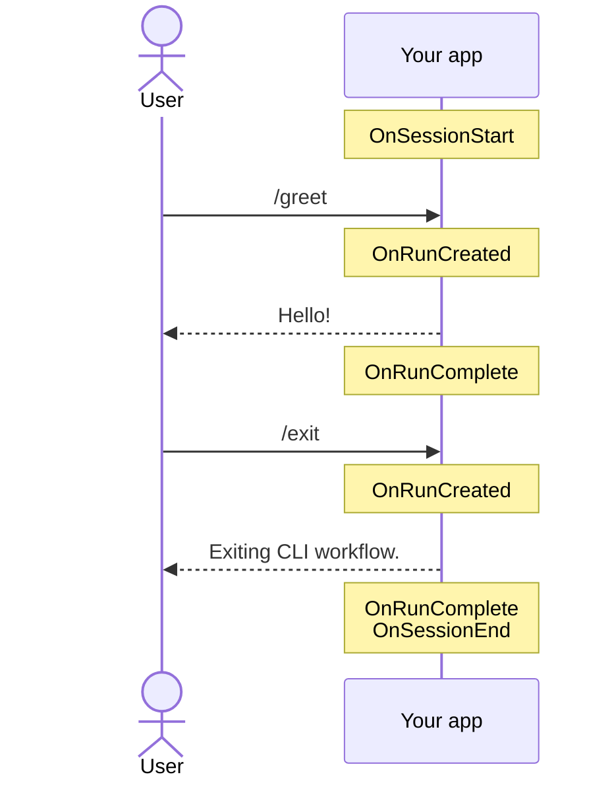

# Creating an interactive app

**Register `WithBasicApp()` and your app prompts in a loop until the user exits. Subclass `CliApp` to act at points in the session.** This is what most CLI tools call a REPL. For a single invocation driven from the command line, see [Creating a headless app](creating-a-headless-app.md).

| Term | Meaning |
|---|---|
| Ask | One line the user types, e.g. `/greet`. |
| Run | Every command from the first one up to a final outcome. |
| Session | App launch to app exit. Holds many runs. |
| Hook | A `virtual` method on `CliApp` that does nothing until you override it. |

## How it looks

Each hook fires at one point. The user types `/greet` and then `/exit`:



`OnMovingPastAsk` fires once for each step a run takes past its ask, such as a chained command or a table's next page.

## How to do it

**1. Register the plain app.** It needs no code of your own.

```csharp
var app = new CliAppBuilder()
    .WithBasicApp()
    .WithRegistry<MyAppRegistry>();

await app.Run();
```

It prompts, runs whatever command each line resolves to, and stops when a command ends the session (see [Exiting the app](exiting-the-app.md)) or the input runs out.

**2. Subclass `CliApp` to hook in.** Register it with `WithApp<TCliApp>()` instead of `WithBasicApp()`.

```csharp
public class MyApp(ICliWorkflow workflow, ICliIo io) : CliApp(workflow, io)
{
    protected override void OnSessionStart()
    {
        Io.Say("Welcome!");
        Io.SetTitle("My App");
    }

    protected override void OnRunComplete(ICliWorkflowRun run, Outcome[] outcomes)
        => Io.Say($"Run took {run.State.Stopwatch.ElapsedMilliseconds}ms.");
}
```

| Hook | Fires |
|---|---|
| `OnSessionStart` | Once, before the loop starts. |
| `OnRunCreated` | When the workflow hands back a run, before the run is driven. |
| `OnMovingPastAsk` | While a run takes a queued step instead of a fresh ask. |
| `OnRunComplete` | After a run's outcomes are written. |
| `OnSessionEnd` | Once, after the loop stops. |

Override only what you need. `OnRunStarted` also exists but is obsolete: it fires straight after `OnRunCreated`, so override `OnRunCreated` instead.

## Common mistakes

- **Subclassing `CliApp` to change static output text.** To reword a built-in message, write an `IOutcomeIoWriter` (see [Outcome writing](../concepts/outcome-writing.md)). Hooks govern when something happens, writers govern how an outcome renders.
- **Doing setup in `OnMovingPastAsk`.** It fires while its step executes, neither before nor after. Use it for progress, never for work a run depends on.
- **Passing a `HeadlessCliApp` subclass to `WithApp<T>()`, then calling `Run()` with no arguments.** The base class decides the mode and nothing switches at runtime. `CliAppBuilder.Run` throws an `ArgumentException` naming the app type.
- **Overriding `Run` to observe a session.** `Run` is `virtual` because `HeadlessCliApp` replaces the loop wholesale. Overriding it means owning the ask loop and every step's outcome writing. Reach for a hook first.

## Learn more

- [Creating a headless app](creating-a-headless-app.md): the one-invocation alternative.
- [Creating a registry](creating-a-registry.md): wiring up the commands, and settings, an app runs.
- [CLI app host](../concepts/cli-app-host.md): what `CliApp.Run` does each iteration, and when each hook fires.
