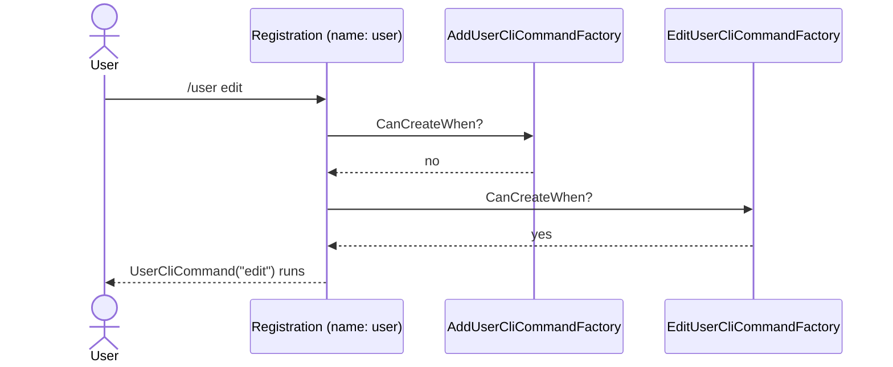

# Creating sub-commands

**Give each sub-command word its own `CliCommandFactory<T>`, gated by `SubCommandIs(...)`.** `/user add` and `/user edit` then both start `user` and each does something different, with no branching inside one `Create()`.

| Term | Meaning |
|---|---|
| Sub-command word | The word after the command name: `add` in `/user add`. |
| Factory | The `CliCommandFactory<T>` that builds a command from the ask. |
| `CanCreateWhen()` | The factory's yes-or-no on whether it builds this ask. |

## How it looks



## How to do it

**1. Write one factory per sub-command word.**

```csharp
public record UserCliCommand(string Action) : CliCommand;

public class AddUserCliCommandFactory : CliCommandFactory<UserCliCommand>
{
    public override bool CanCreateWhen() => SubCommandIs("add");
    public override CliCommand Create() => new UserCliCommand("add");
}

public class EditUserCliCommandFactory : CliCommandFactory<UserCliCommand>
{
    public override bool CanCreateWhen() => SubCommandIs("edit");
    public override CliCommand Create() => new UserCliCommand("edit");
}
```

`AddCommandsFromAssembly` registers every factory for `UserCliCommand` under the one name, `user`. Each ask tries the factories in turn and runs the first whose `CanCreateWhen()` says yes. `TestMultipleFactoriesCliCommand` in `KitCli.Playground.Scenarios` is a runnable copy.

A sub-command is one word today. `/user edit team lead` arrives as the single string `"edit team lead"`. See [how many sub-commands one instruction can address](../investigations/how-many-sub-commands-can-one-instruction-address.md).

**2. Build a different command for a sub-command word.** A factory's type argument sets the name the user types, but `Create()` can return any command. This makes `/source choose` run the asking command from [Asking for a missing value and carrying on](asking-for-a-missing-value-and-carrying-on.md):

```csharp
public record SourceCliCommand : CliCommand;

public class SourceChooseCliCommandFactory : CliCommandFactory<SourceCliCommand>
{
    public override bool CanCreateWhen() => SubCommandIs("choose");
    public override CliCommand Create() => new ChooseSourceCliCommand(ReturnTo: null);
}
```

`SourceCliCommand` never runs, so it needs no handler. In an interactive app the user's choice is remembered, and their next `/export` reads it.

## Common mistakes

- **Typing an unlisted word and expecting an error.** `/user delete`, with no matching factory, fails to resolve like a typo.
- **Two factories matching the same word.** Whichever KitCli finds first wins, silently. Keep every `CanCreateWhen()` mutually exclusive.
- **Splitting into factories with nothing to split.** If every sub-command builds the same fields, one factory branching on `SubCommandIs(...)` inside `Create()` is simpler. Split when a sub-command needs its own constructor arguments.

## Learn more

- [Gating a command with CanCreateWhen](gating-a-command-with-cancreatewhen.md): how `CanCreateWhen` decides whether one factory's command is offered.
- [Command registration](../concepts/command-registration.md): how registration keys factories by name and resolves them first-match-wins.
