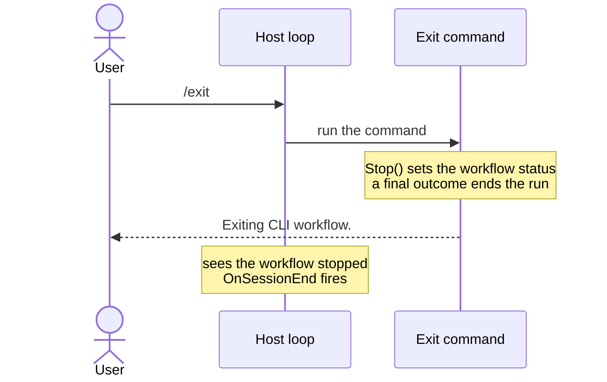

# Exiting the app

**Type `/exit` or `/e` and the session ends. To end it from your own command, call `Stop()` and return a final outcome.**

| Term | Meaning |
|---|---|
| Run | Every command from the first one up to a final outcome. |
| Final outcome | An outcome that ends the run. |
| Workflow | The object the host loop asks for runs. `Stop()` makes the loop quit. |

## How it looks



## How to do it

**1. Use the built-in command.** Any app built with `WithBasicApp()` or `WithApp<TCliApp>()` registers it. There is nothing to write.

**2. End the session from your own command by doing both halves.** Inject `ICliWorkflow`, call `Stop()`, and return a final outcome, as the built-in exit command does.

```csharp
public class LogOutAndExitCliCommandHandler(ICliWorkflow cliWorkflow)
    : CliCommandHandler<LogOutAndExitCliCommand>
{
    public override Task<Outcome[]> HandleCommand(LogOutAndExitCliCommand command, CancellationToken cancellationToken)
    {
        cliWorkflow.Stop();

        return FinishThisCommand()
            .ByFinallySaying("Logged out. Exiting.")
            .EndAsync();
    }
}
```

| Half | Does | Missing it |
|---|---|---|
| `Stop()` | Sets the workflow status, so the host loop stops asking. | A final outcome alone ends the run, and the loop starts another. |
| Final outcome | Ends the current run. | `Stop()` alone leaves the run in progress. |

## Common mistakes

- **Assuming a final outcome alone stops the app.** It ends the current run. An interactive host then starts a new one and asks again, unless you also call `ICliWorkflow.Stop()`.
- **Reaching for `Environment.Exit`, or throwing, to end the session.** Both skip `OnSessionEnd` and any cleanup your app's hooks perform.

## Learn more

- [Workflow run state machine](../concepts/workflow-run-state-machine.md): what a final outcome does to a run's state.
- [CLI app host](../concepts/cli-app-host.md): the host loop reading `Workflow.Status` each iteration, and `OnSessionEnd` firing once it stops.
