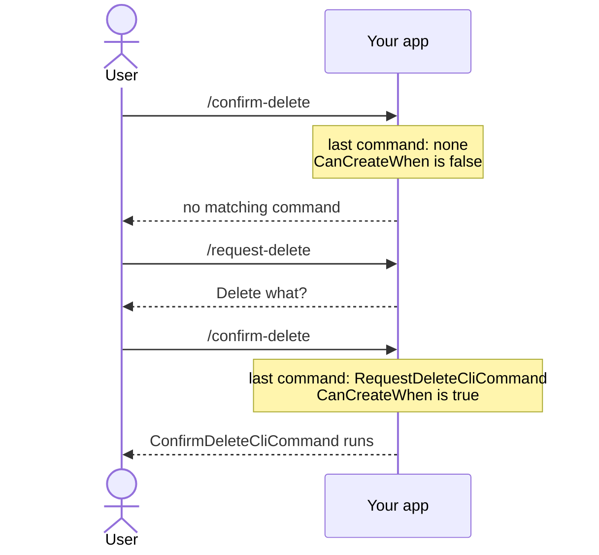

# Gating a command with CanCreateWhen

**Put the condition for a command in `CanCreateWhen()` on its factory, and an ask that should not work never reaches a handler.** Gate on a sub-command word or on what already ran in this run.

| Term | Meaning |
|---|---|
| Factory | The `CliCommandFactory<T>` that builds a command from the ask. |
| Sub-command word | The word after the command name: `test` in `/start test`. |
| Run | Every command from the first one up to a final outcome. |

## How it looks



## How to do it

**1. Gate on a sub-command word.** `BasicDecisionCliCommandFactory<T>` writes `Create()` for you, leaving `CanCreateWhen` to fill in:

```csharp
public record StartCliCommand : CliCommand;

public class StartCliCommandFactory : BasicDecisionCliCommandFactory<StartCliCommand>
{
    public override bool CanCreateWhen() => SubCommandIs("test");
}
```

`/start test` resolves to `StartCliCommand`. `/start` and `/start anything-else` fall through to "no matching command", as though no factory existed.

**2. Gate on what already happened in this run.** Any `CliCommandFactory<T>` can call `LastCommandIs<T>()`:

```csharp
public class ConfirmDeleteCliCommandFactory : CliCommandFactory<ConfirmDeleteCliCommand>
{
    public override bool CanCreateWhen() => LastCommandIs<RequestDeleteCliCommand>();

    public override CliCommand Create() => new ConfirmDeleteCliCommand();
}
```

`/confirm-delete` before `/request-delete` fails to resolve. This needs `AddArtefactFactoriesForAssembly` in your registry: without it `LastCommandIs` is always `false`. See [Creating a registry](creating-a-registry.md).

**3. Accept a repeat of the same step.** `LastCommandIsOneOf` takes two to five types:

```csharp
public class NextPageCliCommandFactory : CliCommandFactory<NextPageCliCommand>
{
    public override bool CanCreateWhen() => LastCommandIsOneOf<ListCliCommand, NextPageCliCommand>();

    public override CliCommand Create() => new NextPageCliCommand();
}
```

Turning a page twice works: the second `/next-page` follows a `NextPageCliCommand`.

| Check | True when |
|---|---|
| `LastCommandIs<T>()` | `T` is the step immediately before. |
| `LastCommandIsOneOf<A, B>()` | One of the listed types is the step immediately before. |
| `AnyLastCommandIs<T>()` | `T` ran at any earlier point in the run. |
| `LastCommandWas<T>()` | Same as `AnyLastCommandIs<T>()`, but obsolete: its name suggests the latest only. |

## Common mistakes

- **Putting the check inside the handler.** A handler that runs and then asks "was this valid?" asks one step too late. Move eligibility into `CanCreateWhen`.
- **Expecting a `false` to give the user a helpful error.** The ask fails like a typo. No "almost matched" message exists. To tell the user the valid moves, declare them on the previous command with `[CliNextCommandIs(name, description)]`: see [Suggesting what to run next](suggesting-what-to-run-next.md).

## Learn more

- [Writing a basic command](writing-a-basic-command.md): when you need a factory at all.
- [Reading command arguments](reading-command-arguments.md): the argument helpers `CanCreateWhen` can also read.
- [Command registration](../concepts/command-registration.md): where `CanCreateWhen` sits in resolution. Keyed DI narrows the candidates, `CanCreateWhen` picks among them, first match wins.
- [Creating sub-commands](creating-sub-commands.md): several `CliCommandFactory<T>` for one command type, one per sub-command word.
