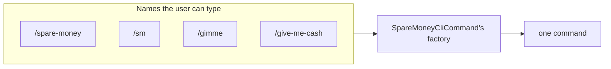

# Giving a command extra names

**Add `[CliCommandAlias("name")]` to a command type and it answers to that name as well.** A better name never costs a type rename.

| Term | Meaning |
|---|---|
| Derived names | The two names KitCli builds from the type: the full `spare-money` and the shorthand `sm`. |
| Alias | An extra name you declare with `[CliCommandAlias]`. |

## How it looks



## How to do it

**Apply the attribute to the command type, once per name.**

```csharp
[CliCommandAlias("gimme")]
[CliCommandAlias("give-me-cash")]
public record SpareMoneyCliCommand : CliCommand;
```

`/spare-money`, `/sm`, `/gimme` and `/give-me-cash` all reach the same command, built by the same factory. In the playground, `/test-aliased`, `/gimme` and `/give-me-cash` are one command, `TestAliasedCliCommand`.

Write aliases as the user types them: lowercase, dash-separated, no prefix character. Everything after the first space is a sub-command, not part of the name.

| Who | Sees aliases |
|---|---|
| The user typing an ask | Yes. |
| [Chaining](chaining-commands.md) | No. It names the next command by type. |
| A [suggestion](suggesting-what-to-run-next.md) | May name one, since the user types it. |

## Common mistakes

- **Expecting the alias to replace the derived names.** It adds to them. `/spare-money` and `/sm` keep working and neither can be turned off. To change the primary name, rename the type.
- **Capitalising an alias.** Names match exactly, so `[CliCommandAlias("Gimme")]` answers to `/Gimme`, not `/gimme`.
- **Aliasing to a name something else answers to.** The alias registers anyway and the ask resolves to whichever factory registered first, which follows assembly order. Nothing reports the clash ([#19](https://github.com/KitCli/KitCli/issues/19)). Shorthands collide too: `TestAliasedCliCommand` and `TestAggregatorCliCommand` both stem to `ta`.

## Learn more

- [Command registration](../concepts/command-registration.md): how a type name becomes an instruction name, and how the keyed registration an alias adds to works.
- [The command alias ADR](../adr/cli-command-alias-attribute.md): why extra names are declared on the type rather than configured elsewhere.
