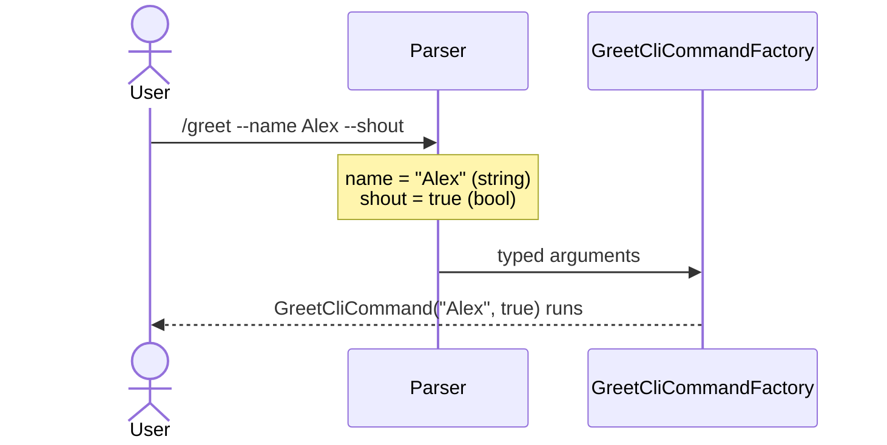

# Reading command arguments

**A factory hands you `--name value` pairs already typed, so you never parse a raw string.** Ask for an argument by type and name; the value looks after its own type.

| Term | Meaning |
|---|---|
| Ask | One line the user types, e.g. `/greet --name Alex`. |
| Argument | A `--name value` pair in the ask. |
| Factory | The `CliCommandFactory<T>` that builds a command from the ask. |

## How it looks



## How to do it

**1. Read arguments by type and name inside a `CliCommandFactory<T>`.**

```csharp
public class GreetCliCommandFactory : CliCommandFactory<GreetCliCommand>
{
    public override bool CanCreateWhen() => true;

    public override CliCommand Create()
    {
        var name = GetRequiredArgument<string>("name").Value;
        var shout = GetArgument<bool>("shout")?.Value ?? false;

        return new GreetCliCommand(name, shout);
    }
}
```

`/greet --name Alex --shout` gives `"Alex"` and `true`. A bool written with no value is `true`. `/greet --name Alex` leaves `shout` unset, so `?? false` applies.

**2. Pick the helper that matches how optional the argument is.**

```csharp
protected InstructionArgument<T>? GetArgument<T>(string? argumentName);
protected InstructionArgument<T> GetRequiredArgument<T>(string? argumentName);
protected bool AnyArgument<T>(string? argumentName);
```

| Helper | When the argument is missing |
|---|---|
| `GetArgument<T>` | Returns `null`. |
| `GetRequiredArgument<T>` | Throws. |
| `AnyArgument<T>` | Returns `false`. |

Passing `null` as the name matches the last argument of that type. Use that only for a command taking exactly one argument of the type.

**3. Know what decides the type.** A value's type comes from what the value looks like, not from the command. Each raw string goes to these in order, and the first to claim it wins:

| Type | Claims a value that... | Example |
|---|---|---|
| `DirectoryInfo` | is a rooted path, or starts with `.` | `--out ./reports` |
| `Guid` | parses as a GUID | `--id 6f9e...` |
| `string` | has at least one letter, and isn't `true`/`false` | `--name Alex` |
| `int` | parses as a whole number | `--count 5` |
| `decimal` | parses as a decimal | `--limit 12.50` |
| `DateOnly` | parses as a date | `--due 2026-03-01` |
| `bool` | is anything left, including no value at all | `--shout` |

So `--name 42` is an `int`, not a `string`. A value can contain `--`: `/note --text a--b` sets `text` to `a--b`. It cannot sit directly in front of a word: `--text see --help` reads `help` as a second argument. You cannot add a type beyond this list today.

## Common mistakes

- **Calling `GetRequiredArgument<T>` for something optional.** It throws when the argument is missing. Use `GetArgument<T>` with a fallback.
- **Asking for the wrong type.** `GetArgument<int>("page")` returns `null` for `--page` (a `bool`), `--page abc` (a `string`) and no `--page` at all. Nothing tells "present but the wrong shape" from "absent".
- **Reaching for `GetArgument` inside a handler.** These helpers live on `CliCommandFactory<T>` alone. By the time a handler runs, the command holds the data it needs.

## Learn more

- [Writing a basic command](writing-a-basic-command.md): where a factory fits, and when you need one.
- [Instruction parsing pipeline](../concepts/instruction-parsing-pipeline.md): how a raw ask becomes typed arguments, and why the type list is closed.
- [Artefacts](../concepts/artefacts.md): `GetArtefact` and `GetRequiredArtefact`, the equivalents for data from earlier commands in the same run.
