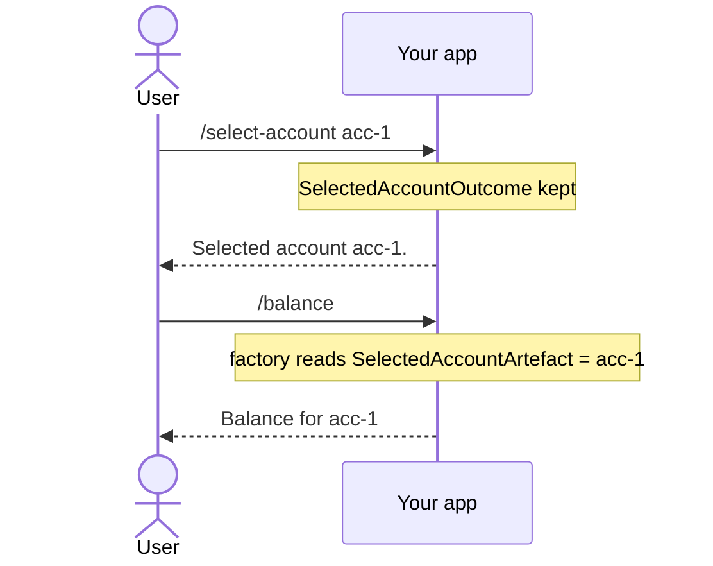

# Remembering your own state

**Keep a value of your own, such as a selected account, so a later command in the same run reads it back. It takes three types and one registry call.**

| Term | Meaning |
|---|---|
| Outcome | What a command returns. A `Reusable` outcome keeps the run going and its data available. |
| Artefact | An outcome turned into a value a later command looks up by type and name. |
| Artefact factory | The class that turns one outcome type into its artefact. |
| Run | Every command from the first one up to a final outcome. |

[Remembering state across separate asks](reusable-outcomes-and-the-workflow-run.md) covers the built-in `Reusable` outcomes, such as page size and filters. This guide is the same recipe for your own value.

## How it looks



## How to do it

**1. Write a `Reusable` outcome.** Your handler returns it.

```csharp
public record SelectedAccountOutcome(string AccountId) : Outcome(OutcomeKind.Reusable);
```

**2. Write an artefact.** A later factory looks it up.

```csharp
public record SelectedAccountArtefact(string AccountId)
    : Artefact<string>(nameof(SelectedAccountArtefact), AccountId);
```

**3. Write a factory that turns one into the other.**

```csharp
public class SelectedAccountArtefactFactory : ArtefactFactory<SelectedAccountOutcome>
{
    protected override AnonymousArtefact CreateArtefact(SelectedAccountOutcome outcome)
        => new SelectedAccountArtefact(outcome.AccountId);
}
```

**4. Raise the outcome with `ByResultingIn`.** It takes any `Outcome`. Keep the reusable outcome last.

```csharp
return FinishThisCommand()
    .BySaying($"Selected account {command.AccountId}.")
    .ByResultingIn(new SelectedAccountOutcome(command.AccountId))
    .EndAsync();
```

**5. Optional: add a `By...` method, as the built-ins have.** It returns `OutcomeList`, so it chains wherever `ByRememberingPageSize` would.

```csharp
public static class OutcomeListExtensions
{
    extension(OutcomeList outcomes)
    {
        public OutcomeList ByRememberingSelectedAccount(string accountId)
            => outcomes.ByResultingIn(new SelectedAccountOutcome(accountId));
    }
}
```

**6. Read it back in a later command's factory.**

```csharp
var accountId = GetRequiredArtefact<string>(nameof(SelectedAccountArtefact)).Value;
```

**7. Call `AddArtefactFactoriesForAssembly(assembly)` in your registry.** It is separate from `AddCommandsFromAssembly`. It finds every `ArtefactFactory<>` in the assembly, so you never name `SelectedAccountArtefactFactory`. See [Creating a registry](creating-a-registry.md).

## Common mistakes

- **Forgetting `AddArtefactFactoriesForAssembly`.** All three types compile and the outcome returns. `GetRequiredArtefact` then throws at runtime in the later command.
- **Ending on `ByFinallySaying`.** Only the final outcome decides what the run does next. It finishes the run and discards the account you just selected.
- **Skipping the artefact and factory to re-read the run's history yourself.** That bypasses the type-and-name lookup every other piece of remembered state uses. Write the three types, however small the value.
- **Making an outcome `Reusable` when nothing reads it back.** With no factory querying it, it needs no artefact pair. An `Anonymous` outcome suffices for something informational.
- **Giving two custom artefacts the same `Name`, or none.** `GetArtefact<T>` filters by type, then by name if given, and takes the last match. An unnamed or colliding lookup silently returns whichever was set most recently.

## Learn more

- [Remembering state across separate asks](reusable-outcomes-and-the-workflow-run.md): the built-in `Reusable` outcomes this pattern generalises.
- [Artefacts](../concepts/artefacts.md): registration, "last match wins" lookup, and where a factory's artefact list comes from.
- [Outcomes](../concepts/outcomes.md): the full `Outcome` and `OutcomeKind` model a custom outcome plugs into.
