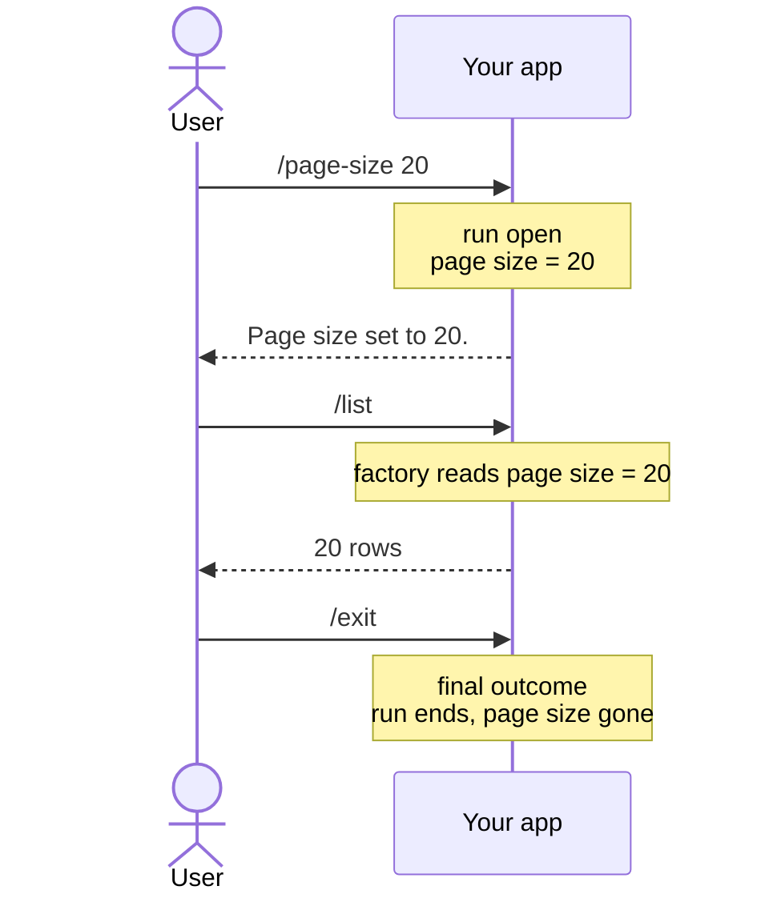

# Remembering state across separate asks

**Return a `Reusable` outcome and every later command in the same run can read it back, with no storage of your own.** A user sets a page size, then asks for "next page" several times. A user picks a filter, then runs several list commands that all respect it.

| Term | Meaning |
|---|---|
| Outcome | What a command returns: "show this", or "here's what happens next". |
| `Reusable` outcome | An outcome that keeps the run open and its data readable. |
| `Final` outcome | An outcome that ends the run. |
| Artefact | An outcome turned into a value a later factory looks up by type and name. |
| Run | Every command from the first one up to a final outcome. |

## How it looks



## How to do it

**1. Return a `Reusable` outcome from a handler.**

```csharp
public class SetPageSizeCliCommandHandler : CliCommandHandler<SetPageSizeCliCommand>
{
    public override Task<Outcome[]> HandleCommand(SetPageSizeCliCommand command, CancellationToken ct)
        => FinishThisCommand()
            .BySaying($"Page size set to {command.PageSize}.")
            .ByRememberingPageSize(command.PageSize)
            .EndAsync();
}
```

`BySaying` is anonymous, so it can go before or after `ByRememberingPageSize`. The last outcome that is not anonymous decides what the run does next. A `Final` outcome after it ends the run and takes the page size with it.

**2. Read it back in a later command's factory.** `OutcomeList` has a `By...` method for each built-in reusable outcome: `ByRememberingPageSize`, `ByRememberingPageNumber`, `ByRememberingFilter`, `ByAggregating`, and more. Read one with `GetArtefact<int>` or `GetRequiredArtefact<int>` inside a `CliCommandFactory<T>`.

### Continuing without a fresh ask

A `Reusable` outcome waits for the user. To run the very next step at once, move to a command:

| You return | What happens next |
|---|---|
| A plain `Reusable` outcome, such as `ByRememberingPageSize` | The run waits for the user's next ask, which can read this as an artefact. |
| `ByMovingToCommand<TCommand>()` | The run builds a `TCommand` through its factory and executes it in the same turn, with no ask. |
| A `Final` outcome, such as `ByFinallySaying` | The run ends. |

## Common mistakes

- **Ending the handler on `ByFinallySaying` after remembering something.** This is the usual way to lose state you just saved. Say the confirmation with `BySaying`, which has no effect on the run.
- **Expecting a `Reusable` outcome to run something at once.** It only makes state available to whatever the user asks for next. To run the next step without new input, use `ByMovingToCommand`.
- **Assuming remembered state outlives the run.** A `Final` outcome discards everything the run remembered, page size included. To keep a value of your own for every later run, give its outcome a session lifetime: see [how long an outcome lasts](../concepts/outcomes.md#how-long-an-outcome-lasts). Nothing survives the app exiting, so separate one-shot invocations never share state.
- **Returning two reusable outcomes a later command reads by type, with no distinguishing name.** If two values in one run both become `Artefact<int>`, a lookup by type alone gets whichever was set most recently. Give each a `Name` whenever more than one could exist.

## Learn more

- [Chaining commands together](chaining-commands.md): the "continue without a fresh ask" half of this picture.
- [Remembering your own state](remembering-your-own-state.md): remembering a value of your own, not just the built-ins.
- [Artefacts](../concepts/artefacts.md): how a `Reusable` outcome becomes something a later factory can query.
- [Workflow run state machine](../concepts/workflow-run-state-machine.md): the state machine beneath, `ReachedReusableOutcome` against `MovePastAsk`.
