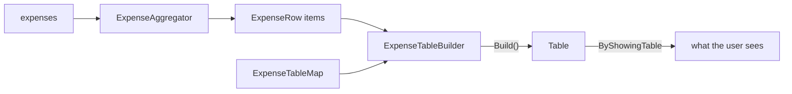

# Showing a table

**Turn a list of things into columns a reader can scan.** You say what a row is, name its columns, and build the table.

```
+------------------------+
| Category  | Total Cost |
|-----------+------------|
| Groceries | 412.80     |
|-----------+------------|
| Rent      | 1150.00    |
+------------------------+
```

| Term | Meaning |
|---|---|
| Row type | A record with one property per column, e.g. `ExpenseRow`. |
| Aggregator | Turns your source items into row-type items. |
| Table map | Names each column of the row type. |
| Table builder | Joins aggregator, map and paging into a `Table`. |

## How it looks



## How to do it

**1. Say what a row is, and where rows come from.**

```csharp
public record ExpenseRow(string Category, decimal TotalCost);

public record ExpenseAggregator(IEnumerable<Expense> Source)
    : Aggregator<Expense, ExpenseRow>(Source)
{
    protected override IEnumerable<ExpenseRow> DoAggregation(IEnumerable<Expense> source)
        => source
            .GroupBy(e => e.Category)
            .Select(g => new ExpenseRow(g.Key, g.Sum(e => e.Cost)));
}
```

**2. Name the columns.** One line per property, all of them.

```csharp
public class ExpenseTableMap : TableMap<ExpenseRow>
{
    public ExpenseTableMap()
    {
        Map(x => x.Category).Name("Category");
        Map(x => x.TotalCost).Name("Total Cost");
    }
}
```

**3. Subclass the builder.** It adds nothing. The type is the point.

```csharp
public class ExpenseTableBuilder : TableBuilder<Expense, ExpenseRow>;
```

**4. Build it and show it.** Give a page size and number even when you never page: `Build()` throws without them.

```csharp
var table = new ExpenseTableBuilder()
    .WithAggregator(new ExpenseAggregator(expenses)
        .BeforeAggregation(source => source.Where(e => e.Cost > 0))
        .AfterAggregation(rows => rows.OrderByDescending(r => r.TotalCost)))
    .WithMap<ExpenseTableMap>()
    .WithPageSize(20)
    .WithPageNumber(1)
    .Build();

return FinishThisCommand().ByShowingTable(table).EndAsync();
```

### Choosing the style

```csharp
.WithStyle(CliTableStyle.None)
```

```
Category  Total Cost
Groceries 412.80
Rent      1150.00
```

`CliTableStyle.Markdown` suits output somebody pastes into an issue:

```
| Category  | Total Cost |
| --------- | ---------- |
| Groceries | 412.80     |
| Rent      | 1150.00    |
```

There are nineteen styles. `Ascii` is the default, the box at the top of this page. [Styling a table](styling-a-table.md) draws every one.

### Holding a column narrow

```csharp
.WithMaxColumnWidth(30)
```

```
+--------------------------------------------+
| Category  | Note                           |
|-----------+--------------------------------|
| Groceries | Weekly shop, plus the birthday |
|           | cake for the office on Friday  |
+--------------------------------------------+
```

Without it, the note takes one long line and the table grows to fit.

### When you already have the rows

```csharp
var table = new Table(
    ["Command", "Description"],
    [["/exit", "End the session."]]);
```

## Common mistakes

- **Mapping only the columns you want shown.** Every public property of the row type is looked up in the map, and an unmapped one throws. Keep a property off the table by keeping it off the row type.
- **Sorting after `Build()`.** Sort on the aggregator. A built table is columns and rows with no pipeline behind it.

## Learn more

- [Showing a paged table](showing-a-paged-table.md): walking a reader through a long list.
- [Styling a table](styling-a-table.md): all nineteen frames, drawn.
- [Tables](../concepts/tables.md): why the map is mandatory, and what a column still cannot say.
- [Aggregators](../concepts/aggregators.md): the pipeline beneath step 1.
