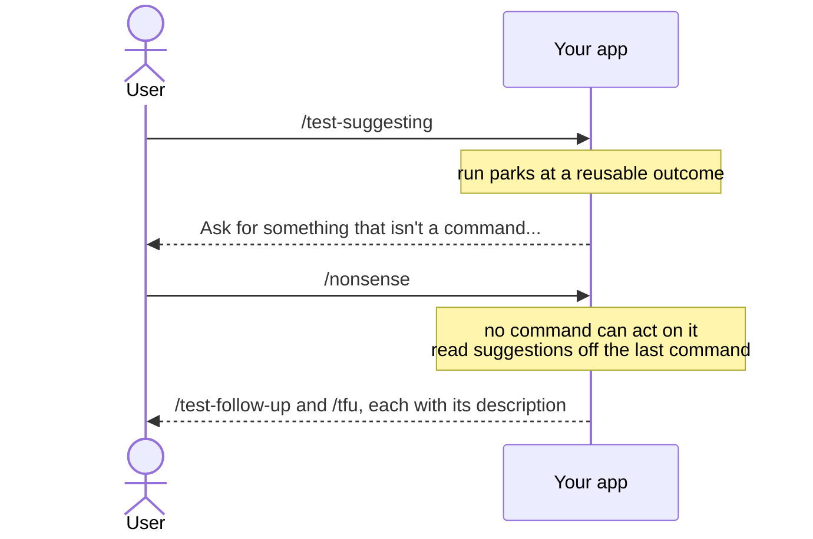

# Suggesting what to run next

**Declare `[CliNextCommandIs]` on the command that parks the run, and the user sees a list of what to type next.** Without it, a run that leads nowhere says nothing.

| Term | Meaning |
|---|---|
| Run | Every command from the first one up to a final outcome. |
| Parked run | A run waiting for the next ask, because its last outcome is reusable. |
| Suggestion | A command name and description printed for the user. |

## How it looks



## How to do it

**1. Put one attribute per suggestion on the command that parks the run, not the one being suggested.**

```csharp
[CliNextCommandIs("test-follow-up", "Pick up where /test-suggesting left off.")]
[CliNextCommandIs("tfu", "The same command, by its shorthand name.")]
public record TestSuggestingCliCommand : CliCommand;

public record TestSuggestingOutcome() : Outcome(OutcomeKind.Reusable);

public class TestSuggestingCliCommandHandler : CliCommandHandler<TestSuggestingCliCommand>
{
    public override Task<Outcome[]> HandleCommand(TestSuggestingCliCommand command, CancellationToken ct)
    {
        var outcome = new TestSuggestingOutcome();

        return FinishThisCommand()
            .BySaying("Ask for something that isn't a command to see what this suggests.")
            .ByResultingIn(outcome)
            .EndAsync();
    }
}
```

This is the playground's own `/test-suggesting`. Type it, then `/nonsense`, and it prints:

```
/test-follow-up
Pick up where /test-suggesting left off.

/tfu
The same command, by its shorthand name.
```

Give the name without a prefix character: the run adds the app's configured one. Any name the user could type works, including a shorthand or an [alias](giving-a-command-extra-names.md).

**2. Suggest after commands that move on with `[CliNextCommandCouldBe]`.** It suggests commands once a command finishes. A command ending with `ByMovingToCommand<B>()` has not finished, so it prints nothing. Only the last command in the chain prints, and only its own suggestions:

```csharp
[CliNextCommandCouldBe("export", "Export the results.")]
public record StepOneCliCommand : CliCommand;

[CliNextCommandCouldBe("share", "Share the results.")]
public record StepTwoCliCommand : CliCommand;
```

When `StepOneCliCommand` ends with `ByMovingToCommand<StepTwoCliCommand>()`, `/step-one` prints `/share` and never `/export`. Declare the suggestions on the command that ends the chain.

## Common mistakes

- **Declaring suggestions on a command that finishes the run.** They are read off the last command that ran, and only while the run is parked. End on a `Final` outcome and the next ask starts a fresh run, silent as ever.
- **Writing the prefix into the name.** `[CliNextCommandIs("/next", ...)]` renders as `//next`.
- **Expecting suggestions only for a misspelled command.** Anything the parked run cannot act on prints them: an unknown name, a command gated off by `CanCreateWhen`, plain text with no prefix.

## Learn more

- [Remembering state across separate asks](reusable-outcomes-and-the-workflow-run.md): what parks a run at a reusable outcome.
- [Workflow run state machine](../concepts/workflow-run-state-machine.md): where suggestions sit in the run's state machine.
