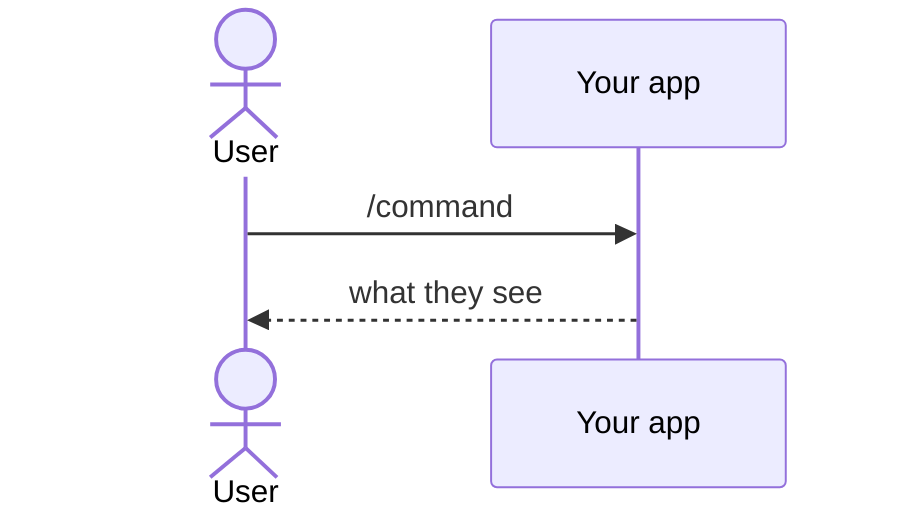

<!--
A user guide shows how to do one task with KitCli, black-box. Write for a
consumer getting something done, in the second person and present tense.
How it works underneath belongs in a concept doc: link it instead. State a
decision as a rule ("use X when Y"), never as narrated internals.

How to explain. The model is
docs/investigations/can-an-artefact-outlive-the-run-that-made-it.md.

- Lead with the answer, in one or two bold sentences.
- Using more than two KitCli terms? Define them first in a
  Term | Meaning table, with the codebase's real names.
- Let diagrams carry the explanation. Pick the mermaid type by what it shows:
  - sequenceDiagram: what happens over time. `Note over` shows the state
    at each step. Show a change as a "before" and an "after" diagram.
  - stateDiagram-v2: a lifetime or a status.
  - classDiagram: the types a reader writes or extends. Generics are `Artefact~T~`.
  - flowchart LR: data moving through stages. One `subgraph` per run,
    request or package.
- Show usage with real code that compiles on `main`.
- Put facts in tables: Fact | Consequence, File | Shows.
- Prose only connects the visuals: a sentence or two saying what the next
  one shows. No paragraph that a diagram, snippet or table could replace.
  Keep prose under 60 lines; diagrams, code and tables don't count.
- Verify every name, signature and sample against source.
-->

# Title

**What you can do once you know this, in one or two bold sentences.**

| Term | Meaning |
|---|---|
| Command | What the user types, e.g. `/execute`. |

## How it looks



## How to do it

**1. The first step, as a bold one-line summary.**

```csharp
public record ExampleCliCommand(string Value) : CliCommand;
```

**2. The next step.**

```csharp
public class ExampleCliCommandHandler : CliCommandHandler<ExampleCliCommand>
{
    public override Task<Outcome[]> HandleCommand(ExampleCliCommand command, CancellationToken cancellationToken)
        => FinishThisCommand()
            .ByFinallySaying($"You typed {command.Value}.")
            .EndAsync();
}
```

## Common mistakes

- **The mistake.** What happens, and the fix.

## Learn more

- [Concept doc](../concepts/example.md): the "why" underneath.
