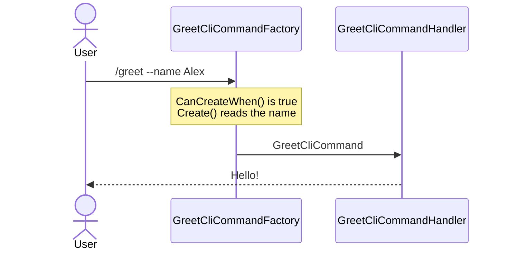

# Writing a basic command

**Write two small types and the user can type your command's name. A third type, a factory, is only for commands that need arguments or a decision.**

| Term | Meaning |
|---|---|
| Command | What the user types, e.g. `/greet`. A `CliCommand` record holds its data, never behaviour. |
| Handler | The class that does the work for one command. |
| Factory | The class that decides whether a command applies right now, and builds it. |
| Outcome | What a handler returns: "show this", or "here's what happens next". |

## How it looks



## How to do it

**1. Write the command and its handler.** Put both in the assembly your app registers.

```csharp
public record GreetCliCommand : CliCommand;

public class GreetCliCommandHandler : CliCommandHandler<GreetCliCommand>
{
    public override Task<Outcome[]> HandleCommand(GreetCliCommand command, CancellationToken cancellationToken)
        => FinishThisCommand()
            .ByFinallySaying("Hello!")
            .EndAsync();
}
```

`GreetCliCommand` answers to `/greet` and the shorthand `/g`, the first letter of each capitalised word. KitCli derives both by stripping the word `CliCommand` from the type name.

**2. Register commands that live outside your `Program.cs` assembly.** Commands beside `Program.cs` register themselves.

```csharp
public class MyAppRegistry : ICliAppRegistry
{
    public void Register(IServiceCollection services)
        => services.AddCommandsFromAssembly(typeof(GreetCliCommand).Assembly);
}
```

**3. Add a factory when the command needs arguments, earlier data or a runtime decision.** That includes every command with constructor parameters.

```csharp
public record GreetCliCommand(string Name) : CliCommand;

public class GreetCliCommandFactory : CliCommandFactory<GreetCliCommand>
{
    public override bool CanCreateWhen() => true;

    public override CliCommand Create()
    {
        var name = GetRequiredArgument<string>("name");

        return new GreetCliCommand(name.Value);
    }
}
```

Pick the base class by the half you need to write:

| Base class | Write | Use when |
|---|---|---|
| `CliCommandFactory<T>` | both methods | you need custom building and gating |
| `BasicCreationCliCommandFactory<T>` | `Create()` only | the command always applies, but needs building |
| `BasicDecisionCliCommandFactory<T>` | `CanCreateWhen()` only | the command is `new T()`, but applies only sometimes |

A command with a public parameterless constructor and no gating needs no factory. KitCli registers `BasicCliCommandFactory<T>` for it, which is why step 1 works alone.

## Common mistakes

- **Naming the type `...Command`.** The derivation strips only `CliCommand`. `GreetCommand` answers to `/greet-command`.
- **Writing a factory for every command out of habit.** With a parameterless constructor and no need for arguments, artefacts or a decision, a factory is boilerplate.
- **Giving a command constructor parameters but no factory.** The automatic factory covers only types KitCli can build with `new`. Startup says nothing and the command is unreachable when someone types its name.
- **Expecting the handler to see the raw ask.** Parsing finishes before `HandleCommand` runs. The command instance is all the handler gets.

## Learn more

- [Reading command arguments](reading-command-arguments.md): the arguments a factory reads.
- [Gating a command with CanCreateWhen](gating-a-command-with-cancreatewhen.md): what `CanCreateWhen` is for, and how a `false` fails.
- [Command registration](../concepts/command-registration.md): how the name is derived and how the factory is chosen.
